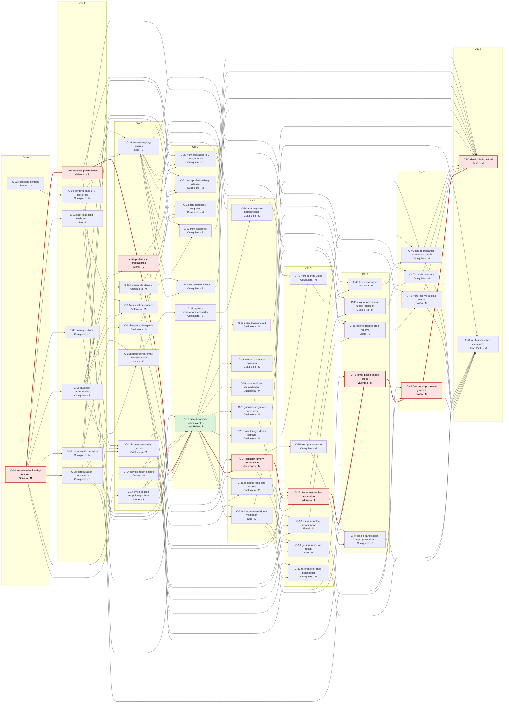

# CHANGES — Secuencia de Implementación

> Índice canónico de todos los changes del proyecto **Turnos Odontología** (turnos y agenda para un consultorio odontológico argentino).
> Cada change es atómico: una funcionalidad que una persona implementa en una sesión (S ≈ 2-3 h, M ≈ 4-6 h, L ≈ 8-10 h).
> **Leer este archivo antes de empezar un item.**

**Equipo (6):** Juan Pablo (líder, dueño del repositorio, revisa todos los PR a `master`), Santino, Valentino, Lionel, Julián y Nico.
**Stack:** Java 21 + Spring Boot 3 (JPA con `ddl-auto`, sin Flyway) + PostgreSQL 16 en Docker + React, TypeScript y Vite; tests con JUnit 5, Testcontainers y Vitest. Monolito modular, un paquete por módulo (`knowledge-base/08_arquitectura_propuesta.md`).
**Tamaño del plan:** 51 changes en 9 olas (Ola 0 a Ola 8).

---

## Asignación rápida

> **Avance al 2026-11-23:** 16 de 51 changes hechos (Ola 0 y Ola 1 completas; Ola 2: C-10, C-11, C-12, C-13, C-16 y C-17; Ola 3: C-20). Falta archivar en OpenSpec: C-20. Ya se pueden empezar: C-14 (Santino), C-15 (Julián), C-19 (Juan Pablo, camino crítico) y C-18, C-21, C-22, C-23 y C-24 (Cualquiera). Desde el PR #84 hay CI: cada PR corre los tests del backend y del frontend, y `master` exige que pasen.

> **Con dueño** = changes críticos (camino crítico o gobernanza HIGH/CRITICAL), asignados a una persona fija. **Cualquiera** = changes no críticos: los toma quien esté libre, siguiendo las [reglas de "Cualquiera"](#reglas-para-tomar-un-change-cualquiera). Santino tiene solo 3 changes fijos (el esqueleto C-01 y C-02, y el servicio de tokens C-14); después se suma a los "Cualquiera".

"Depende de" = changes que tienen que estar **mergeados en `master` antes** de empezar ese change. "—" = no depende de nada (se puede hacer apenas abre su ola).

| Change | Estado | Responsable | Ola | Tam. | Nombre | Depende de (hacer antes) | Marca |
|---|---|---|---|---|---|---|---|
| C-01 | ✅ hecho | **Santino** | 0 | M | esqueleto-backend-y-entorno | — | camino crítico |
| C-02 | ✅ hecho | **Santino** | 0 | S | esqueleto-frontend | — |  |
| C-03 | ✅ hecho | **Nico** | 1 | L | seguridad-login-sesion-csrf | C-01 | CRITICAL |
| C-04 | ✅ hecho | **Valentino** | 1 | S | catalogo-prestaciones | C-01 | camino crítico |
| C-05 | ✅ hecho | Nico (Cualquiera) | 1 | S | catalogo-sillones | C-01 |  |
| C-06 | ✅ hecho | Nico (Cualquiera) | 1 | S | catalogo-profesionales | C-01 |  |
| C-07 | ✅ hecho | Juan Pablo y Julián (Cualquiera) | 1 | M | pacientes-ficha-basica | C-01 |  |
| C-08 | ✅ hecho | Nico (Cualquiera) | 1 | S | configuracion-parametros | C-01 |  |
| C-09 | ✅ hecho | Valentino (Cualquiera) | 1 | M | frontend-base-ui-y-cliente-api | C-02 |  |
| C-10 | ✅ hecho | **Lionel** | 2 | S | profesional-prestaciones | C-04, C-06 | camino crítico |
| C-11 | ✅ hecho | Valentino (Cualquiera) | 2 | M | horarios-de-atencion | C-06 |  |
| C-12 | ✅ hecho | Nico (Cualquiera) | 2 | S | bloqueos-de-agenda | C-06 |  |
| C-13 | ✅ hecho | **Valentino** | 2 | M | administrar-usuarios | C-03, C-06 | CRITICAL |
| C-14 | ⬜ pendiente | **Santino** | 2 | S | servicio-token-seguro | C-01 | CRITICAL |
| C-15 | ⬜ pendiente | **Julián** | 2 | M | notificaciones-email-infraestructura | C-01, C-07, C-08 | HIGH |
| C-16 | ✅ hecho | **Nico** | 2 | S | frontend-login-y-guards | C-03, C-09 | HIGH |
| C-17 | ✅ hecho | **Lionel** | 2 | S | limite-de-tasa-endpoints-publicos | C-01 | HIGH |
| C-18 | ⬜ pendiente | Cualquiera | 2 | M | lista-espera-alta-y-gestion | C-04, C-06, C-07 |  |
| C-19 | ⬜ pendiente | **Juan Pablo** | 3 | L | crear-turno-sin-solapamientos | C-03, C-04, C-05, C-07, C-10, C-11, C-12 | OPSX evaluado, camino crítico, HIGH |
| C-20 | ✅ hecho | Julián (Cualquiera) | 3 | S | front-prestaciones-y-configuracion | C-04, C-08, C-16 |  |
| C-21 | ✅ hecho | Lionel (Cualquiera) | 3 | M | front-profesionales-y-sillones | C-05, C-06, C-10, C-16 |  |
| C-22 | ⬜ pendiente | Cualquiera | 3 | M | front-horarios-y-bloqueos | C-11, C-12, C-16 |  |
| C-23 | ⬜ pendiente | Cualquiera | 3 | S | front-pacientes | C-07, C-16 |  |
| C-24 | ✅ hecho | Lionel (Cualquiera) | 3 | S | front-usuarios-admin | C-13, C-16 |  |
| C-25 | ⬜ pendiente | Cualquiera | 3 | S | registro-notificaciones-consulta | C-15 |  |
| C-26 | ⬜ pendiente | Cualquiera | 4 | M | horarios-libres-disponibilidad | C-19 |  |
| C-27 | ⬜ pendiente | **Juan Pablo** | 4 | M | cancelar-turno-y-liberar-hueco | C-08, C-19 | camino crítico |
| C-28 | ⬜ pendiente | Cualquiera | 4 | M | consultar-agenda-dia-semana | C-19 |  |
| C-29 | ⬜ pendiente | Cualquiera | 4 | S | marcar-asistencia-ausencia | C-19 |  |
| C-30 | ⬜ pendiente | Cualquiera | 4 | M | guardas-integridad-con-turnos | C-04, C-05, C-06, C-12, C-19 |  |
| C-31 | ⬜ pendiente | Cualquiera | 4 | M | compatibilidad-lista-espera | C-18, C-19 |  |
| C-32 | ⬜ pendiente | **Nico** | 4 | M | token-turno-emision-y-validacion | C-14, C-19 | CRITICAL |
| C-33 | ⬜ pendiente | Cualquiera | 4 | M | datos-ficticios-seed | C-03, C-05, C-07, C-10, C-11, C-19 |  |
| C-34 | ⬜ pendiente | Cualquiera | 4 | S | front-registro-notificaciones | C-16, C-25 |  |
| C-35 | ⬜ pendiente | Cualquiera | 5 | M | reprogramar-turno | C-19, C-27 |  |
| C-36 | ⬜ pendiente | **Valentino** | 5 | L | oferta-hueco-aviso-automatico | C-08, C-14, C-15, C-18, C-27, C-31 | camino crítico, HIGH |
| C-37 | ⬜ pendiente | Cualquiera | 5 | M | recordatorio-email-planificador | C-08, C-15, C-19, C-32 |  |
| C-38 | ⬜ pendiente | **Lionel** | 5 | M | reserva-publica-disponibilidad | C-08, C-10, C-17, C-26 | HIGH |
| C-39 | ⬜ pendiente | **Nico** | 5 | M | gestion-turno-por-token | C-17, C-27, C-32 | CRITICAL |
| C-40 | ⬜ pendiente | Cualquiera | 5 | M | front-agenda-vistas | C-09, C-16, C-28 |  |
| C-41 | ⬜ pendiente | **Lionel** | 6 | L | reserva-publica-crear-reserva | C-07, C-08, C-15, C-17, C-19, C-32, C-38 | HIGH |
| C-42 | ⬜ pendiente | **Valentino** | 6 | M | tomar-hueco-desde-oferta | C-17, C-19, C-32, C-36 | camino crítico, HIGH |
| C-43 | ⬜ pendiente | Cualquiera | 6 | M | asignacion-manual-hueco-recepcion | C-19, C-26, C-31, C-36 |  |
| C-44 | ⬜ pendiente | Cualquiera | 6 | S | emails-cancelacion-reprogramacion | C-15, C-27, C-35 |  |
| C-45 | ⬜ pendiente | Cualquiera | 6 | M | front-crear-turno | C-07, C-19, C-26, C-40 |  |
| C-46 | ⬜ pendiente | Cualquiera | 7 | M | front-reprogramar-cancelar-asistencia | C-27, C-29, C-35, C-45 |  |
| C-47 | ⬜ pendiente | Cualquiera | 7 | M | front-lista-espera | C-16, C-18, C-31, C-43 |  |
| C-48 | ⬜ pendiente | **Julián** | 7 | M | front-reserva-publica-reservar | C-09, C-38, C-41 | HIGH |
| C-49 | ⬜ pendiente | **Julián** | 7 | M | front-turno-por-token-y-oferta | C-09, C-39, C-42 | camino crítico, HIGH |
| C-50 | ⬜ pendiente | **Julián** | 8 | M | identidad-visual-final | C-20, C-21, C-22, C-23, C-24, C-34, C-45, C-46, C-47, C-48, C-49 | camino crítico |
| C-51 | ⬜ pendiente | **Juan Pablo** | 8 | M | verificacion-e2e-y-cierre-mvp | C-33, C-37, C-44, C-46, C-47, C-48, C-49 |  |

---

## Cómo usar este documento

1. **Identificar el item:** buscá tu change en la tabla de [Carga por integrante](#carga-por-integrante) y abrí su ficha en la fase (ola) correspondiente.
2. **Verificar dependencias y leer la KB:** todo lo que figura en `Depende de` debe estar mergeado en `master`; leé los punteros de `Leer antes` y las preguntas abiertas del change.
3. **Acordar alcance y verificación:** confirmá el alcance con Juan Pablo y el criterio de salida; los changes HIGH proponen y esperan revisión, los CRITICAL solo analizan hasta tener aprobación explícita. El resto de los changes se implementa con TDD estricto (test fallido primero).
4. **Verificar el resultado:** corré los tests (`mvn verify` y `npm test`) y comprobá el criterio de salida antes de abrir el PR.
5. **Actualizar el estado:** marcá `[x]` en el campo `Estado` del change al mergear el PR.

### Flujo de trabajo del equipo

- **Una rama por integrante** (por ejemplo `dev/santino`) y **un PR por change** hacia `master`, con el ID en el título (`C-19 crear-turno-sin-solapamientos`). Juan Pablo revisa y mergea todos los PR.
- No se abre el change siguiente en la misma rama hasta que el PR anterior esté mergeado: después de cada merge, `git rebase master`.
- PR chicos y un solo change por PR. Si un change necesita tocar un archivo compartido (`application.yml`, `pom.xml`, `package.json`, `schema-constraints.sql`, `shared/`), avisá al equipo antes y hacelo en un commit aparte.
- **Change OPSX evaluado:** solo `crear-turno-sin-solapamientos` (C-19) recorre el ciclo OPSX completo (explore, propose, apply, verify, archive) con specs. Los demás changes se implementan con el ritmo normal del equipo.

---

## Árbol de dependencias

### Tabla de dependencias

| Change | Ola | Responsable | Tam. | Gobernanza | Depende de | Desbloquea |
|---|---|---|---|---|---|---|
| `C-01` esqueleto-backend-y-entorno (camino crítico) | 0 | Santino | M | MEDIUM | ninguno | C-03, C-04, C-05, C-06, C-07, C-08, C-14, C-15, C-17 |
| `C-02` esqueleto-frontend | 0 | Santino | S | LOW | ninguno | C-09 |
| `C-03` seguridad-login-sesion-csrf | 1 | Nico | L | CRITICAL | C-01 | C-13, C-16, C-19, C-33 |
| `C-04` catalogo-prestaciones (camino crítico) | 1 | Valentino | S | LOW | C-01 | C-10, C-18, C-19, C-20, C-30 |
| `C-05` catalogo-sillones | 1 | Cualquiera | S | LOW | C-01 | C-19, C-21, C-30, C-33 |
| `C-06` catalogo-profesionales | 1 | Cualquiera | S | LOW | C-01 | C-10, C-11, C-12, C-13, C-18, C-21, C-30 |
| `C-07` pacientes-ficha-basica | 1 | Cualquiera | M | MEDIUM | C-01 | C-15, C-18, C-19, C-23, C-33, C-41, C-45 |
| `C-08` configuracion-parametros | 1 | Cualquiera | S | MEDIUM | C-01 | C-15, C-20, C-27, C-36, C-37, C-38, C-41 |
| `C-09` frontend-base-ui-y-cliente-api | 1 | Cualquiera | M | LOW | C-02 | C-16, C-40, C-48, C-49 |
| `C-10` profesional-prestaciones (camino crítico) | 2 | Lionel | S | LOW | C-04, C-06 | C-19, C-21, C-33, C-38 |
| `C-11` horarios-de-atencion | 2 | Cualquiera | M | MEDIUM | C-06 | C-19, C-22, C-33 |
| `C-12` bloqueos-de-agenda | 2 | Cualquiera | S | MEDIUM | C-06 | C-19, C-22, C-30 |
| `C-13` administrar-usuarios | 2 | Valentino | M | CRITICAL | C-03, C-06 | C-24 |
| `C-14` servicio-token-seguro | 2 | Santino | S | CRITICAL | C-01 | C-32, C-36 |
| `C-15` notificaciones-email-infraestructura | 2 | Julián | M | HIGH | C-01, C-07, C-08 | C-25, C-36, C-37, C-41, C-44 |
| `C-16` frontend-login-y-guards | 2 | Nico | S | HIGH | C-03, C-09 | C-20, C-21, C-22, C-23, C-24, C-34, C-40, C-47 |
| `C-17` limite-de-tasa-endpoints-publicos | 2 | Lionel | S | HIGH | C-01 | C-38, C-39, C-41, C-42 |
| `C-18` lista-espera-alta-y-gestion | 2 | Cualquiera | M | MEDIUM | C-04, C-06, C-07 | C-31, C-36, C-47 |
| `C-19` crear-turno-sin-solapamientos **(Change OPSX evaluado)** (camino crítico) | 3 | Juan Pablo | L | HIGH | C-03, C-04, C-05, C-07, C-10, C-11, C-12 | C-26, C-27, C-28, C-29, C-30, C-31, C-32, C-33, C-35, C-37, C-41, C-42, C-43, C-45 |
| `C-20` front-prestaciones-y-configuracion | 3 | Cualquiera | S | LOW | C-04, C-08, C-16 | C-50 |
| `C-21` front-profesionales-y-sillones | 3 | Cualquiera | M | LOW | C-05, C-06, C-10, C-16 | C-50 |
| `C-22` front-horarios-y-bloqueos | 3 | Cualquiera | M | LOW | C-11, C-12, C-16 | C-50 |
| `C-23` front-pacientes | 3 | Cualquiera | S | LOW | C-07, C-16 | C-50 |
| `C-24` front-usuarios-admin | 3 | Cualquiera | S | MEDIUM | C-13, C-16 | C-50 |
| `C-25` registro-notificaciones-consulta | 3 | Cualquiera | S | LOW | C-15 | C-34 |
| `C-26` horarios-libres-disponibilidad | 4 | Cualquiera | M | MEDIUM | C-19 | C-38, C-43, C-45 |
| `C-27` cancelar-turno-y-liberar-hueco (camino crítico) | 4 | Juan Pablo | M | MEDIUM | C-08, C-19 | C-35, C-36, C-39, C-44, C-46 |
| `C-28` consultar-agenda-dia-semana | 4 | Cualquiera | M | LOW | C-19 | C-40 |
| `C-29` marcar-asistencia-ausencia | 4 | Cualquiera | S | MEDIUM | C-19 | C-46 |
| `C-30` guardas-integridad-con-turnos | 4 | Cualquiera | M | MEDIUM | C-04, C-05, C-06, C-12, C-19 | ninguno (hoja) |
| `C-31` compatibilidad-lista-espera | 4 | Cualquiera | M | MEDIUM | C-18, C-19 | C-36, C-43, C-47 |
| `C-32` token-turno-emision-y-validacion | 4 | Nico | M | CRITICAL | C-14, C-19 | C-37, C-39, C-41, C-42 |
| `C-33` datos-ficticios-seed | 4 | Cualquiera | M | LOW | C-03, C-05, C-07, C-10, C-11, C-19 | C-51 |
| `C-34` front-registro-notificaciones | 4 | Cualquiera | S | LOW | C-16, C-25 | C-50 |
| `C-35` reprogramar-turno | 5 | Cualquiera | M | MEDIUM | C-19, C-27 | C-44, C-46 |
| `C-36` oferta-hueco-aviso-automatico (camino crítico) | 5 | Valentino | L | HIGH | C-08, C-14, C-15, C-18, C-27, C-31 | C-42, C-43 |
| `C-37` recordatorio-email-planificador | 5 | Cualquiera | M | MEDIUM | C-08, C-15, C-19, C-32 | C-51 |
| `C-38` reserva-publica-disponibilidad | 5 | Lionel | M | HIGH | C-08, C-10, C-17, C-26 | C-41, C-48 |
| `C-39` gestion-turno-por-token | 5 | Nico | M | CRITICAL | C-17, C-27, C-32 | C-49 |
| `C-40` front-agenda-vistas | 5 | Cualquiera | M | LOW | C-09, C-16, C-28 | C-45 |
| `C-41` reserva-publica-crear-reserva | 6 | Lionel | L | HIGH | C-07, C-08, C-15, C-17, C-19, C-32, C-38 | C-48 |
| `C-42` tomar-hueco-desde-oferta (camino crítico) | 6 | Valentino | M | HIGH | C-17, C-19, C-32, C-36 | C-49 |
| `C-43` asignacion-manual-hueco-recepcion | 6 | Cualquiera | M | MEDIUM | C-19, C-26, C-31, C-36 | C-47 |
| `C-44` emails-cancelacion-reprogramacion | 6 | Cualquiera | S | MEDIUM | C-15, C-27, C-35 | C-51 |
| `C-45` front-crear-turno | 6 | Cualquiera | M | LOW | C-07, C-19, C-26, C-40 | C-46, C-50 |
| `C-46` front-reprogramar-cancelar-asistencia | 7 | Cualquiera | M | MEDIUM | C-27, C-29, C-35, C-45 | C-50, C-51 |
| `C-47` front-lista-espera | 7 | Cualquiera | M | LOW | C-16, C-18, C-31, C-43 | C-50, C-51 |
| `C-48` front-reserva-publica-reservar | 7 | Julián | M | HIGH | C-09, C-38, C-41 | C-50, C-51 |
| `C-49` front-turno-por-token-y-oferta (camino crítico) | 7 | Julián | M | HIGH | C-09, C-39, C-42 | C-50, C-51 |
| `C-50` identidad-visual-final (camino crítico) | 8 | Julián | M | MEDIUM | C-20, C-21, C-22, C-23, C-24, C-34, C-45, C-46, C-47, C-48, C-49 | ninguno (hoja) |
| `C-51` verificacion-e2e-y-cierre-mvp | 8 | Juan Pablo | M | MEDIUM | C-33, C-37, C-44, C-46, C-47, C-48, C-49 | ninguno (hoja) |

### Grafo de dependencias

Se dibujan solo las dependencias directas no redundantes (reducción transitiva). En rojo, el camino crítico; en verde, el Change OPSX evaluado.



Columna vertebral (ASCII):

```
C-01 esqueleto ── C-04/C-06 catálogos ── C-10 / C-11 / C-12 ── C-19 crear-turno ★
                                                                  │
             ┌────────────┬─────────────┬─────────────┬───────────┴──────────┐
          C-26 libres  C-27 cancelar  C-28 agenda   C-29 asistencia    C-32 token-turno
                          │                                                  │
                    C-36 oferta ── C-42 tomar hueco ── C-49 front ── C-50 identidad final
```

### Paralelismo por fase

Regla de las olas: dentro de una misma ola ningún par de changes toca los mismos archivos; si comparten módulo, lo hacen en archivos nuevos y subpaquetes distintos o con el mismo responsable (ver [Riesgos de merge](#riesgos-de-merge-y-mitigaciones)). Un change puede empezar apenas sus propias dependencias están mergeadas aunque la ola anterior no haya terminado; los que solo dependen de C-01 (C-14 y C-17) pueden adelantarse a la Ola 1.

**GATE 0** — abre la Ola 0
- Condición: Repositorio creado por Juan Pablo en GitHub con `master` protegida, una rama por integrante y la convención de PR acordada.
- Requiere mergeados en `master`: nada (arranque del proyecto)
  - `C-01` esqueleto-backend-y-entorno — **Santino**
  - `C-02` esqueleto-frontend — **Santino**

**GATE 1** — abre la Ola 1 ← FORK
- Condición: `docker compose up -d` funciona desde cero; `mvn verify` y `npm test` en verde en `master`; disponibles `Clock`, `ManejadorErrores`, base de Testcontainers, `SecurityConfig` base y el README de arranque.
- Requiere mergeados en `master`: `C-01`, `C-02`
  - `C-03` seguridad-login-sesion-csrf — **Nico**
  - `C-04` catalogo-prestaciones — **Valentino**
  - `C-05` catalogo-sillones — **Cualquiera**
  - `C-06` catalogo-profesionales — **Cualquiera**
  - `C-07` pacientes-ficha-basica — **Cualquiera**
  - `C-08` configuracion-parametros — **Cualquiera**
  - `C-09` frontend-base-ui-y-cliente-api — **Cualquiera**

**GATE 2** — abre la Ola 2 ← FORK
- Condición: Contrato de login de C-03 (OpenAPI) publicado para que C-16 avance; C-04, C-06 y C-07 mergeados antes de arrancar C-10, C-11, C-12 y C-18.
- Requiere mergeados en `master`: `C-01`, `C-03`, `C-04`, `C-06`, `C-07`, `C-08`, `C-09`
  - `C-10` profesional-prestaciones — **Lionel**
  - `C-11` horarios-de-atencion — **Cualquiera**
  - `C-12` bloqueos-de-agenda — **Cualquiera**
  - `C-13` administrar-usuarios — **Valentino**
  - `C-14` servicio-token-seguro — **Santino** (adelantable a la Ola 1)
  - `C-15` notificaciones-email-infraestructura — **Julián**
  - `C-16` frontend-login-y-guards — **Nico**
  - `C-17` limite-de-tasa-endpoints-publicos — **Lionel** (adelantable a la Ola 1)
  - `C-18` lista-espera-alta-y-gestion — **Cualquiera**

**GATE 3** — abre la Ola 3 ← el change evaluado ← FORK
- Condición: C-10, C-11 y C-12 mergeados (cierran RN-04 y RN-11): es el gate real del change evaluado. Juan Pablo libera su agenda de revisiones largas para C-19.
- Requiere mergeados en `master`: `C-03`, `C-04`, `C-05`, `C-06`, `C-07`, `C-08`, `C-10`, `C-11`, `C-12`, `C-13`, `C-15`, `C-16`
  - `C-19` crear-turno-sin-solapamientos — **Juan Pablo** — Change OPSX evaluado
  - `C-20` front-prestaciones-y-configuracion — **Cualquiera**
  - `C-21` front-profesionales-y-sillones — **Cualquiera**
  - `C-22` front-horarios-y-bloqueos — **Cualquiera**
  - `C-23` front-pacientes — **Cualquiera**
  - `C-24` front-usuarios-admin — **Cualquiera**
  - `C-25` registro-notificaciones-consulta — **Cualquiera**

**GATE 4** — abre la Ola 4 ← FORK
- Condición: C-19 mergeado con la entidad `Turno` completa, los eventos de dominio y `schema-constraints.sql`; test de carrera en verde.
- Requiere mergeados en `master`: `C-03`, `C-04`, `C-05`, `C-06`, `C-07`, `C-08`, `C-10`, `C-11`, `C-12`, `C-14`, `C-16`, `C-18`, `C-19`, `C-25`
  - `C-26` horarios-libres-disponibilidad — **Cualquiera**
  - `C-27` cancelar-turno-y-liberar-hueco — **Juan Pablo**
  - `C-28` consultar-agenda-dia-semana — **Cualquiera**
  - `C-29` marcar-asistencia-ausencia — **Cualquiera**
  - `C-30` guardas-integridad-con-turnos — **Cualquiera**
  - `C-31` compatibilidad-lista-espera — **Cualquiera**
  - `C-32` token-turno-emision-y-validacion — **Nico**
  - `C-33` datos-ficticios-seed — **Cualquiera**
  - `C-34` front-registro-notificaciones — **Cualquiera**

**GATE 5** — abre la Ola 5 ← FORK
- Condición: C-27 (publica `HuecoLiberado`), C-26, C-28, C-31 y C-32 mergeados.
- Requiere mergeados en `master`: `C-08`, `C-09`, `C-10`, `C-14`, `C-15`, `C-16`, `C-17`, `C-18`, `C-19`, `C-26`, `C-27`, `C-28`, `C-31`, `C-32`
  - `C-35` reprogramar-turno — **Cualquiera**
  - `C-36` oferta-hueco-aviso-automatico — **Valentino**
  - `C-37` recordatorio-email-planificador — **Cualquiera**
  - `C-38` reserva-publica-disponibilidad — **Lionel**
  - `C-39` gestion-turno-por-token — **Nico**
  - `C-40` front-agenda-vistas — **Cualquiera**

**GATE 6** — abre la Ola 6 ← FORK
- Condición: C-35, C-36, C-38 y C-40 mergeados. PA-08 (texto de consentimiento) respondida antes de C-41 y C-48.
- Requiere mergeados en `master`: `C-07`, `C-08`, `C-15`, `C-17`, `C-19`, `C-26`, `C-27`, `C-31`, `C-32`, `C-35`, `C-36`, `C-38`, `C-40`
  - `C-41` reserva-publica-crear-reserva — **Lionel**
  - `C-42` tomar-hueco-desde-oferta — **Valentino**
  - `C-43` asignacion-manual-hueco-recepcion — **Cualquiera**
  - `C-44` emails-cancelacion-reprogramacion — **Cualquiera**
  - `C-45` front-crear-turno — **Cualquiera**

**GATE 7** — abre la Ola 7
- Condición: C-41, C-42, C-43 y C-45 mergeados.
- Requiere mergeados en `master`: `C-09`, `C-16`, `C-18`, `C-27`, `C-29`, `C-31`, `C-35`, `C-38`, `C-39`, `C-41`, `C-42`, `C-43`, `C-45`
  - `C-46` front-reprogramar-cancelar-asistencia — **Cualquiera**
  - `C-47` front-lista-espera — **Cualquiera**
  - `C-48` front-reserva-publica-reservar — **Julián**
  - `C-49` front-turno-por-token-y-oferta — **Julián**

**GATE 8** — abre la Ola 8
- Condición: Todos los fronts mergeados; el equipo acordó nombre, logo, color primario y tipografía finales; Juan Pablo disponible para aprobar la nueva `Revision` del design system.
- Requiere mergeados en `master`: `C-20`, `C-21`, `C-22`, `C-23`, `C-24`, `C-33`, `C-34`, `C-37`, `C-44`, `C-45`, `C-46`, `C-47`, `C-48`, `C-49`
  - `C-50` identidad-visual-final — **Julián**
  - `C-51` verificacion-e2e-y-cierre-mvp — **Juan Pablo**

### Camino crítico (9 changes, uno por ola; mínimo irreducible)

`C-01` → `C-04` → `C-10` → `C-19` → `C-27` → `C-36` → `C-42` → `C-49` → `C-50`

`C-01 esqueleto` → `C-04 prestaciones` → `C-10 profesional-prestaciones` → **`C-19 crear-turno-sin-solapamientos`** → `C-27 cancelar-turno` → `C-36 oferta-hueco` → `C-42 tomar-hueco` → `C-49 front token y oferta` → `C-50 identidad visual final`.

- Empate en las Olas 1 y 2: `C-06` → `C-11` o `C-12` tiene la misma longitud que `C-04` → `C-10` (los tres changes de la Ola 2 deben estar mergeados para abrir C-19).
- `C-19` está en la Ola 3, que es lo más temprano que permiten las dependencias: necesita prestaciones y profesionales (Ola 1), la asociación profesional-prestación, los horarios y los bloqueos (Ola 2) para validar RN-04 y RN-11. Desbloquea 25 changes.
- Para el MVP funcional el último eslabón es `C-49`; `C-50` (identidad visual) y `C-51` (cierre) son la ola final.

### Changes independientes entre sí

Dentro de cada ola todos los changes son independientes (ninguno depende de otro de su misma ola):

| Ola | Changes mutuamente independientes |
|---|---|
| 0 | C-01, C-02 |
| 1 | C-03, C-04, C-05, C-06, C-07, C-08, C-09 |
| 2 | C-10, C-11, C-12, C-13, C-14, C-15, C-16, C-17, C-18 |
| 3 | C-19, C-20, C-21, C-22, C-23, C-24, C-25 |
| 4 | C-26, C-27, C-28, C-29, C-30, C-31, C-32, C-33, C-34 |
| 5 | C-35, C-36, C-37, C-38, C-39, C-40 |
| 6 | C-41, C-42, C-43, C-44, C-45 |
| 7 | C-46, C-47, C-48, C-49 |
| 8 | C-50, C-51 |

**Independientes del change evaluado C-19** (no lo necesitan ni lo bloquean, se pueden construir en paralelo): C-02, C-08, C-09, C-13, C-14, C-15, C-16, C-17, C-18, C-20, C-21, C-22, C-23, C-24, C-25, C-34.

**Pistas casi independientes** (pueden avanzar a la vez con distintos responsables):

| Pista | Changes |
|---|---|
| Seguridad y usuarios | C-03, C-13, C-14, C-16, C-24, C-32, C-39 |
| Catálogos y horarios | C-04, C-05, C-06, C-10, C-11, C-12, C-20, C-21, C-22, C-30 |
| Agenda y turnos (núcleo) | C-19, C-26, C-27, C-28, C-29, C-35, C-40, C-45, C-46 |
| Lista de espera | C-18, C-31, C-36, C-42, C-43, C-47 |
| Reserva pública | C-17, C-38, C-41, C-48, C-49 |
| Notificaciones por email | C-15, C-25, C-34, C-37, C-44 |
| Soporte transversal | C-01, C-02, C-07, C-08, C-09, C-23, C-33, C-50, C-51 |

### Plan óptimo con 6 integrantes

| Ola | Juan Pablo | Nico | Santino | Julián | Lionel | Valentino |
|---|---|---|---|---|---|---|
| 0 | — | C-01, C-02 | — | — | — | — |
| 1 | — | C-09 | C-03 | C-07 | C-05, C-06 | C-04, C-08 |
| 2 | C-17 | C-16 | C-13, C-14 | C-15 | C-10, C-11, C-18 | C-12 |
| 3 | C-19 | C-20 | — | C-23, C-25 | C-21, C-22 | C-24 |
| 4 | C-27, C-33 | C-28 | C-32 | C-34 | C-29, C-31 | C-26, C-30 |
| 5 | C-35 | C-40 | C-38, C-39 | C-37 | — | C-36 |
| 6 | — | C-45 | C-41 | C-44 | C-43 | C-42 |
| 7 | — | C-46 | — | C-48, C-49 | — | C-47 |
| 8 | C-51 | — | — | C-50 | — | — |

Juan Pablo queda con menos implementación porque revisa todos los PR; en las Olas 2 a 4 solo tiene C-17, C-19, C-27 y C-33 y el resto del tiempo lo dedica a revisar.

---

## Carga por integrante

Estimación en puntos: S = 1, M = 2, L = 3. Solo cuentan los changes **con dueño**; los "Cualquiera" se reparten según disponibilidad.

| Integrante | Changes con dueño (por ola) | Carga fija |
|---|---|---|
| Juan Pablo | Ola 3: C-19 (L); Ola 4: C-27 (M); Ola 8: C-51 (M) | 7 puntos (3 changes) |
| Santino | Ola 0: C-01 (M); Ola 0: C-02 (S); Ola 2: C-14 (S) | 4 puntos (3 changes) |
| Nico | Ola 1: C-03 (L); Ola 2: C-16 (S); Ola 4: C-32 (M); Ola 5: C-39 (M) | 8 puntos (4 changes) |
| Valentino | Ola 1: C-04 (S); Ola 2: C-13 (M); Ola 5: C-36 (L); Ola 6: C-42 (M) | 8 puntos (4 changes) |
| Lionel | Ola 2: C-10 (S); Ola 2: C-17 (S); Ola 5: C-38 (M); Ola 6: C-41 (L) | 7 puntos (4 changes) |
| Julián | Ola 2: C-15 (M); Ola 7: C-48 (M); Ola 7: C-49 (M); Ola 8: C-50 (M) | 8 puntos (4 changes) |
| **Cualquiera** | C-05 (S), C-06 (S), C-07 (M), C-08 (S), C-09 (M), C-11 (M), C-12 (S), C-18 (M), C-20 (S), C-21 (M), C-22 (M), C-23 (S), C-24 (S), C-25 (S), C-26 (M), C-28 (M), C-29 (S), C-30 (M), C-31 (M), C-33 (M), C-34 (S), C-35 (M), C-37 (M), C-40 (M), C-43 (M), C-44 (S), C-45 (M), C-46 (M), C-47 (M) | 47 puntos (29 changes) |

Total: 89 puntos. Si el pool "Cualquiera" se reparte parejo entre los seis, cada integrante termina con ~15 puntos; Juan Pablo debería tomar menos "Cualquiera" porque revisa todos los PR.

### Reglas para tomar un change "Cualquiera"

1. **Respetar la ola:** solo se toma un "Cualquiera" cuyas dependencias (`Depende de`) ya estén mergeadas en `master`. Prioridad: el que más changes desbloquea.
2. **Anotarse antes de empezar:** el que lo toma se asigna el issue/tarjeta del change en GitHub (y avisa en el grupo). Primero que se anota, se lo queda. Nadie tiene más de un "Cualquiera" abierto a la vez.
3. **Los changes con dueño tienen prioridad:** solo se toma un "Cualquiera" si no hay un change propio desbloqueado.
4. **Bloques por módulo (evita conflictos de merge):** si dos "Cualquiera" de la misma ola tocan el mismo paquete o carpeta, los toma la misma persona: C-05 + C-06 (paquete `profesionales`, Ola 1); C-11 + C-12 (horarios y bloqueos, Ola 2, junto a C-10 de Lionel: conviene que los tome Lionel o coordine con él); C-21 + C-22 (front de profesionales, Ola 3); C-26 + C-28 + C-29 (paquete `agenda`, Ola 4: subpaquetes separados, ver RM-04).
5. **Gobernanza:** los "Cualquiera" son LOW o MEDIUM: se implementan con TDD y checkpoints; si al trabajar aparece algo de seguridad o datos sensibles, se avisa a Juan Pablo antes de seguir.

---

## FASE 0 — Ola 0: Esqueleto del proyecto (una sola persona)

> Una sola persona (Santino) deja el esqueleto para que nadie choque en los archivos base. Nada en paralelo hasta el GATE 1.

### [C-01] `C-01-esqueleto-backend-y-entorno`
- **Estado**: `[x]` hecho por Santino (PR #53, 2026-11-21)
- **Responsable**: Santino — **Ola**: 0 — **Tamaño**: M (4-6 h)
- **Scope**:
  - `backend/` Maven + Java 21 + Spring Boot 3, paquete base `ar.edu.utn.turnos`, `TurnosApplication`; dependencias YA declaradas para todo el proyecto (web, data-jpa, validation, security, mail, postgresql, springdoc-openapi, spring-security-test, Testcontainers, ArchUnit) para que ningún change posterior edite `pom.xml`
  - `docker-compose.yml` con PostgreSQL 16 y volumen; `.env.example` con las variables de 08 §Variables de entorno; `.gitignore` con `.env`
  - `application.yml` con un bloque comentado por módulo (cada change agrega solo el suyo), `application-dev.yml` (`ddl-auto: update`), `application-test.yml` (`create-drop`); `schema-constraints.sql` con solo `CREATE EXTENSION IF NOT EXISTS btree_gist` y el separador `^^^` configurado
  - `shared`: `Clock` inyectable en zona `America/Argentina/Buenos_Aires`, `ReglaNegocioException(codigo, estadoHttp)` y `ManejadorErrores` (Problem Details RFC 7807 para 409/422/404/403) que mapea cualquier `ReglaNegocioException`, de modo que ningún change vuelva a editarlo
  - `SecurityConfig` base: deny-by-default, `/api/public/**` abierto, `@EnableMethodSecurity` (el login real llega en C-03; los demás changes usan `@PreAuthorize` y se testean con usuarios simulados)
  - Base de tests: clase base con PostgreSQL 16 de Testcontainers, perfil `test`, test que comprueba que `btree_gist` está disponible y que un error de regla responde Problem Details
  - `README.md` raíz con el arranque (`docker compose up -d`, `mvn spring-boot:run`)
- **Depende de**: ninguno
- **Desbloquea**: `C-03`, `C-04`, `C-05`, `C-06`, `C-07`, `C-08`, `C-14`, `C-15`, `C-17`
- **Governance**: MEDIUM (implementar por pasos y mostrar las decisiones no obvias)
- **Reglas que cubre**: RN-14, RN-35 — Historias: US-021
- **Leer antes**:
  - `knowledge-base/08_arquitectura_propuesta.md` §Estructura de directorios, §Gestión del esquema (Hibernate), §Variables de entorno, §Entorno y despliegue
  - `knowledge-base/02_descripcion_general.md` §Stack tecnológico
  - `knowledge-base/09_decisiones_y_supuestos.md` DD-01, DD-02, DD-08
- **Criterio de salida**: `docker compose up -d` levanta PostgreSQL 16 desde cero; `mvn verify` en verde en una máquina limpia con Testcontainers; el test de `btree_gist` y el de Problem Details pasan; `.env` no está versionado; PR aprobado por Juan Pablo.
- **Riesgo o precondición**: PA-10 (Flyway): el esquema depende de `ddl-auto: update`, que no borra ni renombra columnas; ante un cambio incompatible se recrea la base ficticia (`docker compose down -v`).

### [C-02] `C-02-esqueleto-frontend`
- **Estado**: `[x]` hecho por Santino (PR #54, 2026-11-21)
- **Responsable**: Santino — **Ola**: 0 — **Tamaño**: S (2-3 h)
- **Scope**:
  - `frontend/` Vite + React 18 + TypeScript 5 + React Router + Vitest + Testing Library; `package.json` con TODAS las dependencias previstas (para no volver a editarlo)
  - Proxy de Vite `/api` hacia el backend (mismo origen, cookies sin CORS abierto) y `VITE_API_BASE_URL`
  - Estructura `src/{app,shared,features}` con las carpetas de 08 §Estructura; `main.tsx` importa `design-system/tokens.css` y el binding de `brand.js`
  - Test de humo Vitest que renderiza `App` y comprueba el nombre tomado de `BRAND`; scripts `dev`, `build`, `test`, `lint`
- **Depende de**: ninguno
- **Desbloquea**: `C-09`
- **Governance**: LOW (autonomía plena si los tests pasan)
- **Reglas que cubre**: -
- **Leer antes**:
  - `knowledge-base/08_arquitectura_propuesta.md` §Estructura de directorios (frontend), §Entorno y despliegue
  - `design-system/README.md` §Consumir los tokens desde React/Vite
  - `knowledge-base/02_descripcion_general.md` §Stack tecnológico
- **Criterio de salida**: `npm ci && npm run build && npm test` en verde; `npm run dev` sirve la SPA con los tokens del design system aplicados; PR aprobado por Juan Pablo.
- **Riesgo o precondición**: Sin dependencia técnica de C-01: lo hace la misma persona a continuación para respetar la convención del repositorio (`.gitignore`, `.env.example`).

---

## FASE 1 — Ola 1: Fundaciones paralelas: seguridad, catálogos, pacientes, configuración y base de UI

### [C-03] `C-03-seguridad-login-sesion-csrf`
- **Estado**: `[x]` hecho por Nico (PR #55, 2026-11-21)
- **Responsable**: Nico — **Ola**: 1 — **Tamaño**: L (8-10 h)
- **Scope**:
  - Entidad `Usuario` (email único, hash BCrypt, rol `ODONTOLOGO|RECEPCION|ADMIN`, activo, intentos fallidos, `bloqueado_hasta`) en `seguridad`
  - `POST /api/auth/login`, `POST /api/auth/logout`, `GET /api/auth/me`: sesión de servidor con cookie `HttpOnly`, `SameSite=Lax`, `Secure` según `APP_COOKIE_SECURE`
  - Bloqueo de 15 minutos tras 5 fallos consecutivos (RN-34), mensaje genérico que no distingue la causa, usuario inactivo rechazado
  - CSRF con `CookieCsrfTokenRepository` para `/api/**` autenticado (excepto `/api/public/**`); CORS restringido a `APP_CORS_ORIGIN`
  - Reemplaza el `SecurityConfig` base de C-01 sin romper los `@PreAuthorize` de los demás módulos; bootstrap del admin desde `SEED_ADMIN_PASSWORD` (solo perfil dev)
  - Tests: unitarios de la política de bloqueo con `Clock`; integración MockMvc (login ok, credenciales malas, bloqueo, inactivo, logout, 401 sin sesión, 403 por rol, CSRF)
- **Depende de**: `C-01`
- **Desbloquea**: `C-13`, `C-16`, `C-19`, `C-33`
- **Governance**: CRITICAL (solo análisis y propuesta; sin código hasta la aprobación explícita de Juan Pablo)
- **Reglas que cubre**: RN-33, RN-34 — Historias: US-001
- **Leer antes**:
  - `knowledge-base/03_actores_y_roles.md` §RBAC y reglas de aplicación
  - `knowledge-base/05_reglas_de_negocio.md` RN-33, RN-34
  - `knowledge-base/07_flujos_principales.md` Flujo 6
  - `knowledge-base/08_arquitectura_propuesta.md` §Seguridad
  - `knowledge-base/09_decisiones_y_supuestos.md` DD-03, SU-10
- **Criterio de salida**: Todos los criterios de aceptación de US-001 cubiertos por tests en verde; el 5.º intento fallido bloquea 15 minutos (probado con `Clock`); tras logout la sesión devuelve 401; ninguna contraseña ni cookie aparece en los logs; aprobación explícita de Juan Pablo registrada antes de escribir código.
- **Riesgo o precondición**: CRITICAL: se entrega primero análisis y propuesta (OPSX propose); no se escribe código sin aprobación de Juan Pablo. Valores de bloqueo (5 intentos, 15 min) son supuesto a validar.

### [C-04] `C-04-catalogo-prestaciones`
- **Estado**: `[x]` hecho por Valentino (PR #63, 2026-11-21)
- **Responsable**: Valentino — **Ola**: 1 — **Tamaño**: S (2-3 h)
- **Scope**:
  - Entidad `Prestacion` (nombre, duración por defecto, activa) en `prestaciones`; `/api/prestaciones` CRUD con baja lógica
  - Validación de duración múltiplo de 5 entre 5 y 480 minutos (RN-09) y filtro `soloActivas`
  - Permisos: ADMIN escribe; RECEPCION y ODONTOLOGO leen (403 al escribir); puerto de consulta para otros módulos
  - Tests: unitarios de la validación de duración; integración MockMvc de roles y baja lógica
- **Depende de**: `C-01`
- **Desbloquea**: `C-10`, `C-18`, `C-19`, `C-20`, `C-30`
- **Governance**: LOW (autonomía plena si los tests pasan)
- **Reglas que cubre**: RN-03, RN-09, RN-37 — Historias: US-003
- **Leer antes**:
  - `knowledge-base/06_funcionalidades.md` US-003
  - `knowledge-base/04_modelo_de_datos.md` §Prestacion
  - `knowledge-base/05_reglas_de_negocio.md` RN-03, RN-09, RN-37
  - `knowledge-base/03_actores_y_roles.md` §RBAC
- **Criterio de salida**: Criterios de US-003 cubiertos por tests; una prestación inactiva no aparece con `soloActivas`; duración 7 o 481 devuelve 422.
- **Riesgo o precondición**: La baja con turnos futuros (RN-37) se completa en C-30.

### [C-05] `C-05-catalogo-sillones`
- **Estado**: `[x]` hecho por Nico (PR #56, 2026-11-21)
- **Responsable**: Nico (tomado como Cualquiera) — **Ola**: 1 — **Tamaño**: S (2-3 h)
- **Scope**:
  - Entidad `Sillon` (nombre único, activo) en `profesionales.sillon`; `/api/sillones` CRUD con baja lógica; ADMIN escribe, RECEPCION y ODONTOLOGO leen
  - Puerto de consulta `SillonConsulta` (activos, por id) para agenda
  - Tests: unicidad de nombre, baja lógica, roles
- **Depende de**: `C-01`
- **Desbloquea**: `C-19`, `C-21`, `C-30`, `C-33`
- **Governance**: LOW (autonomía plena si los tests pasan)
- **Reglas que cubre**: RN-37 — Historias: US-004
- **Leer antes**:
  - `knowledge-base/06_funcionalidades.md` US-004
  - `knowledge-base/04_modelo_de_datos.md` §Sillon
  - `knowledge-base/05_reglas_de_negocio.md` RN-01, RN-37
  - `knowledge-base/09_decisiones_y_supuestos.md` SU-08
- **Criterio de salida**: Nombre duplicado devuelve 409; un sillón inactivo no figura entre los activos; 403 a RECEPCION y ODONTOLOGO al escribir.
- **Riesgo o precondición**: PA-12 abierta (bloquear un sillón por intervalo): no se incluye; solo se desactiva. No desactivar con turnos futuros llega en C-30.

### [C-06] `C-06-catalogo-profesionales`
- **Estado**: `[x]` hecho por Nico (PR #57, 2026-11-21)
- **Responsable**: Nico (tomado como Cualquiera) — **Ola**: 1 — **Tamaño**: S (2-3 h)
- **Scope**:
  - Entidad `Profesional` (nombre, apellido, matrícula, activo) en `profesionales.profesional`; `/api/profesionales` CRUD con baja lógica; ADMIN escribe, RECEPCION lee, ODONTOLOGO lee el propio
  - Puerto `ProfesionalConsulta` para agenda, horarios y bloqueos (por id y activos)
  - La asociación con prestaciones (C-10) y el vínculo con usuario (C-13) se agregan en esos changes, sin editar esta entidad
- **Depende de**: `C-01`
- **Desbloquea**: `C-10`, `C-11`, `C-12`, `C-13`, `C-18`, `C-21`, `C-30`
- **Governance**: LOW (autonomía plena si los tests pasan)
- **Reglas que cubre**: RN-37 — Historias: US-005
- **Leer antes**:
  - `knowledge-base/06_funcionalidades.md` US-005
  - `knowledge-base/04_modelo_de_datos.md` §Profesional
  - `knowledge-base/03_actores_y_roles.md` §RBAC
  - `knowledge-base/05_reglas_de_negocio.md` RN-37
- **Criterio de salida**: CRUD de profesionales con baja lógica y permisos por rol cubierto por tests de integración; el puerto devuelve solo activos cuando se pide.
- **Riesgo o precondición**: C-05 y C-06 comparten el paquete `profesionales` en la misma ola; mismo responsable y subpaquetes distintos (ver Riesgo RM-01).

### [C-07] `C-07-pacientes-ficha-basica`
- **Estado**: `[x]` hecho por Juan Pablo a partir del trabajo de Julián (PR #83, 2026-11-23)
- **Responsable**: Juan Pablo y Julián (tomado como Cualquiera) — **Ola**: 1 — **Tamaño**: M (4-6 h)
- **Scope**:
  - Entidad `Paciente` (nombre, apellido, DNI único opcional, email, teléfono, obra social como texto, notas, activo) en `pacientes`
  - `/api/pacientes` crear, editar, buscar (apellido, nombre, DNI o email), baja lógica; RECEPCION y ADMIN; al menos un medio de contacto (RN-32)
  - Puerto `PacienteConsulta` (por id, por email) para agenda, lista de espera y reserva pública
  - Tests: búsqueda, DNI único cuando se informa, contacto obligatorio, no borrado físico con turnos (se completa con C-19)
- **Depende de**: `C-01`
- **Desbloquea**: `C-15`, `C-18`, `C-19`, `C-23`, `C-33`, `C-41`, `C-45`
- **Governance**: MEDIUM (implementar por pasos y mostrar las decisiones no obvias)
- **Reglas que cubre**: RN-32, RN-35 — Historias: US-009
- **Leer antes**:
  - `knowledge-base/06_funcionalidades.md` US-009
  - `knowledge-base/04_modelo_de_datos.md` §Paciente
  - `knowledge-base/05_reglas_de_negocio.md` RN-32, RN-35
  - `knowledge-base/03_actores_y_roles.md` §RBAC
- **Criterio de salida**: Criterios de US-009 cubiertos por tests; DNI duplicado devuelve 409; el listado no expone datos a roles sin acceso; solo datos ficticios en los tests.
- **Riesgo o precondición**: PA-16 (pacientes sin email): se permite email o teléfono, pero sin email no hay recordatorio ni lista de espera. La lectura del odontólogo (solo pacientes de sus turnos) se implementa en C-28.

### [C-08] `C-08-configuracion-parametros`
- **Estado**: `[x]` hecho por Nico (PR #61, 2026-11-21)
- **Responsable**: Nico (tomado como Cualquiera) — **Ola**: 1 — **Tamaño**: S (2-3 h)
- **Scope**:
  - Entidad `Configuracion` (clave, valor, descripción, actualizado_en) en `configuracion` con las 7 claves de 04 §Configuracion y sus valores por defecto (inicializador idempotente)
  - `GET /api/configuracion` (RECEPCION, ADMIN) y `PUT` (solo ADMIN); validación RN-36 (plazo 0 a 168, recordatorio 1 a 168, demás enteros positivos)
  - `ConfiguracionServicio` tipado (`plazoCancelacionHoras()`, `anticipacionRecordatorioHoras()`, límites de reserva online, tope de avisos) que usan los demás módulos
  - Tests: valores por defecto, rangos inválidos devuelven 422, 403 a quien no es ADMIN, el cambio no afecta operaciones pasadas
- **Depende de**: `C-01`
- **Desbloquea**: `C-15`, `C-20`, `C-27`, `C-36`, `C-37`, `C-38`, `C-41`
- **Governance**: MEDIUM (implementar por pasos y mostrar las decisiones no obvias)
- **Reglas que cubre**: RN-05, RN-29, RN-36 — Historias: US-006
- **Leer antes**:
  - `knowledge-base/06_funcionalidades.md` US-006
  - `knowledge-base/04_modelo_de_datos.md` §Configuracion
  - `knowledge-base/05_reglas_de_negocio.md` RN-05, RN-29, RN-36
  - `knowledge-base/09_decisiones_y_supuestos.md` SU-06, SU-11
- **Criterio de salida**: Las 7 claves existen con su valor por defecto tras arrancar; `PUT` con plazo 169 devuelve 422; un RECEPCION recibe 403 al modificar.
- **Riesgo o precondición**: PA-05 (anticipación del recordatorio) abierta: se entrega 24 hs configurable, como indica el supuesto SU-06.

### [C-09] `C-09-frontend-base-ui-y-cliente-api`
- **Estado**: `[x]` hecho por Valentino (PR #64, 2026-11-21)
- **Responsable**: Valentino (tomado como Cualquiera) — **Ola**: 1 — **Tamaño**: M (4-6 h)
- **Scope**:
  - `shared/api`: cliente `fetch` con cookie de sesión, token CSRF y mapeo de Problem Details (409, 422, 404, 403) a errores tipados
  - `shared/fecha`: formateo y parseo en zona `America/Argentina/Buenos_Aires` e intervalos semiabiertos `[inicio, fin)`
  - Kit UI desde `design-system/components.html` (botón, campo, badge de estado de turno, tabla, toast, tarjeta, alerta, layout con navegación) usando solo variables de `tokens.css`
  - Registro automático de rutas y de entradas de menú por `features/*/routes.ts` (`import.meta.glob`) para que ningún change posterior edite el router central
  - Tests Vitest: componentes, fechas (borde de medianoche y zona BA) y mapeo de errores
- **Depende de**: `C-02`
- **Desbloquea**: `C-16`, `C-40`, `C-48`, `C-49`
- **Governance**: LOW (autonomía plena si los tests pasan)
- **Reglas que cubre**: RN-14
- **Leer antes**:
  - `design-system/README.md` y `design-system/components.html`
  - `knowledge-base/08_arquitectura_propuesta.md` §Estructura (frontend), §Seguridad (CSRF)
  - `knowledge-base/05_reglas_de_negocio.md` RN-14 y §Excepciones globales
  - `knowledge-base/07_flujos_principales.md` Flujo 1 (códigos 409/422)
- **Criterio de salida**: Un `features/ejemplo/routes.ts` de prueba aparece en menú y router sin editar archivos centrales; los tests de fecha y de errores pasan; el kit UI no usa colores fuera de `tokens.css`.

---

## FASE 2 — Ola 2: Profesionales completos, usuarios, infraestructura transversal y lista de espera base

> Los tres changes de `profesionales` (C-10, C-11, C-12) van en subpaquetes distintos y son la condición de apertura de C-19.

### [C-10] `C-10-profesional-prestaciones`
- **Estado**: `[x]` hecho por Lionel (PR #68, 2026-11-22)
- **Responsable**: Lionel — **Ola**: 2 — **Tamaño**: S (2-3 h)
- **Scope**:
  - Entidad `ProfesionalPrestacion` (`@ManyToOne` a `Profesional` y `Prestacion`, pareja única) en `profesionales.prestacion`, sin editar `Profesional`
  - `GET` y `PUT /api/profesionales/{id}/prestaciones` (solo ADMIN escribe)
  - Puerto `ProfesionalRealizaPrestacion` para agenda y reserva pública (RN-11)
  - Tests: asociación y desasociación, prestación inactiva, 403 por rol
- **Depende de**: `C-04`, `C-06`
- **Desbloquea**: `C-19`, `C-21`, `C-33`, `C-38`
- **Governance**: LOW (autonomía plena si los tests pasan)
- **Reglas que cubre**: RN-11 — Historias: US-005
- **Leer antes**:
  - `knowledge-base/06_funcionalidades.md` US-005
  - `knowledge-base/04_modelo_de_datos.md` §ProfesionalPrestacion
  - `knowledge-base/05_reglas_de_negocio.md` RN-11
  - `knowledge-base/09_decisiones_y_supuestos.md` SU-09
- **Criterio de salida**: El puerto responde correctamente para profesionales con y sin la prestación; tests de integración en verde.
- **Riesgo o precondición**: RM-01 (paquete `profesionales` compartido con C-11 y C-12 en la misma ola).

### [C-11] `C-11-horarios-de-atencion`
- **Estado**: `[x]` hecho por Valentino (PR #72, 2026-11-22)
- **Responsable**: Valentino (tomado como Cualquiera) — **Ola**: 2 — **Tamaño**: M (4-6 h)
- **Scope**:
  - Entidad `HorarioAtencion` (profesional, día 1 a 7, tramo `[hora_inicio, hora_fin)` en hora local) en `profesionales.horario`
  - `/api/profesionales/{id}/horarios` CRUD para RECEPCION y ADMIN; ODONTOLOGO solo consulta los propios y recibe 403 al modificar
  - Validación: tramos del mismo profesional y día sin superponerse (RN-16); `fin > inicio`
  - Puerto `HorarioConsulta.contiene(profesionalId, Intervalo)`: el turno debe caber completo en un único tramo, calculado en zona BA (RN-14)
  - Tests: unitarios de tramos (contiguos válidos, superpuestos inválidos, turno que cruza el corte), integración de roles
- **Depende de**: `C-06`
- **Desbloquea**: `C-19`, `C-22`, `C-33`
- **Governance**: MEDIUM (implementar por pasos y mostrar las decisiones no obvias)
- **Reglas que cubre**: RN-04, RN-16, RN-33 — Historias: US-007
- **Leer antes**:
  - `knowledge-base/06_funcionalidades.md` US-007
  - `knowledge-base/04_modelo_de_datos.md` §HorarioAtencion
  - `knowledge-base/05_reglas_de_negocio.md` RN-04, RN-14, RN-16
  - `knowledge-base/03_actores_y_roles.md` §Decisión del líder (horarios)
- **Criterio de salida**: Un turno 12:30-13:00 en un tramo 09:00-13:00 se acepta y 12:45-13:15 se rechaza según el puerto (tests de borde); ODONTOLOGO recibe 403 al escribir.
- **Riesgo o precondición**: RM-01. SU-02: si se decide que recepción no toque horarios, solo cambia la matriz de permisos.

### [C-12] `C-12-bloqueos-de-agenda`
- **Estado**: `[x]` hecho por Nico (PR #67, 2026-11-22)
- **Responsable**: Nico (tomado como Cualquiera) — **Ola**: 2 — **Tamaño**: S (2-3 h)
- **Scope**:
  - Entidad `Bloqueo` (profesional, `[inicio, fin)`, motivo) en `profesionales.bloqueo`; `POST`, `GET` y `DELETE /api/profesionales/{id}/bloqueos` para RECEPCION y ADMIN; ODONTOLOGO solo ve y recibe 403 al escribir
  - Puerto `BloqueoConsulta.solapa(profesionalId, Intervalo)` con intervalo semiabierto: un turno que empieza justo cuando termina el bloqueo se acepta (RN-02)
  - NO incluye el rechazo por turnos activos superpuestos (RN-17): llega en C-30 porque requiere turnos
  - Tests: unitarios del puerto con bordes contiguos, integración de roles y borrado
- **Depende de**: `C-06`
- **Desbloquea**: `C-19`, `C-22`, `C-30`
- **Governance**: MEDIUM (implementar por pasos y mostrar las decisiones no obvias)
- **Reglas que cubre**: RN-02, RN-04, RN-33 — Historias: US-008
- **Leer antes**:
  - `knowledge-base/06_funcionalidades.md` US-008
  - `knowledge-base/04_modelo_de_datos.md` §Bloqueo
  - `knowledge-base/05_reglas_de_negocio.md` RN-02, RN-04, RN-17
  - `knowledge-base/09_decisiones_y_supuestos.md` SU-08
- **Criterio de salida**: Bloqueo 10:00-11:00: turno 10:30-11:30 solapa, turno 11:00-11:30 no (test); se puede eliminar un bloqueo.
- **Riesgo o precondición**: RM-01. PA-12 abierta: solo hay bloqueos por profesional, no por sillón.

### [C-13] `C-13-administrar-usuarios`
- **Estado**: `[x]` hecho por Valentino (PR #71, 2026-11-22)
- **Responsable**: Valentino — **Ola**: 2 — **Tamaño**: M (4-6 h)
- **Scope**:
  - `/api/usuarios` CRUD solo ADMIN: alta con rol, modificación, desactivación; email único; contraseña con BCrypt
  - Campo `profesional_id` en `Usuario`: un ODONTOLOGO se vincula 1:1 a un `Profesional` (validado por el puerto `ProfesionalConsulta`)
  - Desactivar un usuario invalida sus sesiones vigentes
  - Tests: 403 a RECEPCION y ODONTOLOGO, unicidad de email, vínculo 1:1, nunca se devuelve el hash
- **Depende de**: `C-03`, `C-06`
- **Desbloquea**: `C-24`
- **Governance**: CRITICAL (solo análisis y propuesta; sin código hasta la aprobación explícita de Juan Pablo)
- **Reglas que cubre**: RN-33, RN-34 — Historias: US-002
- **Leer antes**:
  - `knowledge-base/06_funcionalidades.md` US-002
  - `knowledge-base/03_actores_y_roles.md` §RBAC
  - `knowledge-base/05_reglas_de_negocio.md` RN-33, RN-34
  - `knowledge-base/08_arquitectura_propuesta.md` §Seguridad
- **Criterio de salida**: Criterios de US-002 cubiertos por tests; un usuario desactivado no puede iniciar sesión y su sesión previa deja de ser válida; aprobación de Juan Pablo antes de codificar.
- **Riesgo o precondición**: CRITICAL: análisis y propuesta primero. Edita `Usuario` de C-03 (mismo módulo, ola posterior y mismo responsable).

### [C-14] `C-14-servicio-token-seguro`
- **Estado**: `[ ]` pendiente
- **Responsable**: Santino — **Ola**: 2 — **Tamaño**: S (2-3 h)
- **Scope**:
  - `shared.token.ServicioToken` (dominio puro): `SecureRandom` de 256 bits en base64url (43 caracteres), hash SHA-256 hexadecimal y comparación en tiempo constante
  - Tipo `TokenGenerado {claro, hash}` con `toString` enmascarado para que el token nunca llegue a un log
  - Tests unitarios: longitud y alfabeto, unicidad en miles de muestras, hash determinista, comparación en tiempo constante, enmascarado
- **Depende de**: `C-01`
- **Desbloquea**: `C-32`, `C-36`
- **Governance**: CRITICAL (solo análisis y propuesta; sin código hasta la aprobación explícita de Juan Pablo)
- **Reglas que cubre**: RN-07, RN-25, RN-38
- **Leer antes**:
  - `knowledge-base/05_reglas_de_negocio.md` RN-25, RN-38, RN-07
  - `knowledge-base/08_arquitectura_propuesta.md` §Seguridad (Token del paciente)
  - `knowledge-base/09_decisiones_y_supuestos.md` DD-06
- **Criterio de salida**: Tests unitarios en verde; el paquete no importa Spring ni JPA (verificable con ArchUnit); aprobación de Juan Pablo antes de codificar.
- **Riesgo o precondición**: Se ubica en `shared.token` (la KB lo nombra dentro de `reservapublica`) para que `listaespera` no dependa de `reservapublica`. Puede adelantarse a la Ola 1 porque solo depende de C-01.

### [C-15] `C-15-notificaciones-email-infraestructura`
- **Estado**: `[ ]` pendiente
- **Responsable**: Julián — **Ola**: 2 — **Tamaño**: M (4-6 h)
- **Scope**:
  - Puerto `NotificacionPort` con `SmtpNotificacionAdapter` (Spring Mail, credenciales solo en `.env`) e `InMemoryNotificacionAdapter` para tests
  - Entidad `NotificacionEnviada` (tipo, estado `PENDIENTE|ENVIADA|FALLIDA`, intentos, último error, `UNIQUE (turno_id, tipo, inicio_referencia)` y `UNIQUE (oferta_hueco_id, tipo)`), con referencias por id
  - Servicio de envío con reintento hasta 3 veces con espera creciente (RN-30) y planificador de reintentos
  - Plantilla de email base con `consultorio.nombre` de C-08, sin datos de otros pacientes
  - Tests: idempotencia, fallo de SMTP deja `FALLIDA` sin perder el turno, reintentos con `Clock`
- **Depende de**: `C-01`, `C-07`, `C-08`
- **Desbloquea**: `C-25`, `C-36`, `C-37`, `C-41`, `C-44`
- **Governance**: HIGH (proponer y esperar revisión antes de escribir)
- **Reglas que cubre**: RN-30, RN-31
- **Leer antes**:
  - `knowledge-base/04_modelo_de_datos.md` §NotificacionEnviada
  - `knowledge-base/05_reglas_de_negocio.md` RN-30, RN-31, RN-35
  - `knowledge-base/07_flujos_principales.md` Flujo 5
  - `knowledge-base/08_arquitectura_propuesta.md` §Patrones (puertos y adaptadores, outbox)
  - `knowledge-base/09_decisiones_y_supuestos.md` DD-07
- **Criterio de salida**: Un envío fallido queda `FALLIDA` con `ultimo_error` y se reintenta hasta 3 veces (test con `InMemoryNotificacionAdapter`); dos inserciones iguales violan la restricción única; ninguna credencial SMTP en el repositorio.
- **Riesgo o precondición**: RM-02 (`application.yml`: bloque de mail).

### [C-16] `C-16-frontend-login-y-guards`
- **Estado**: `[x]` hecho por Nico (PR #70, 2026-11-22)
- **Responsable**: Nico — **Ola**: 2 — **Tamaño**: S (2-3 h)
- **Scope**:
  - `features/auth`: pantalla de login, contexto de sesión (`/api/auth/me`), logout y redirección ante 401
  - Guard `RequireRole` y menú filtrado por rol (la SPA oculta opciones pero la barrera es el backend)
  - Mensaje genérico ante credenciales inválidas y mensaje de cuenta bloqueada
  - Tests Vitest: guards por rol, redirección, mensajes
- **Depende de**: `C-03`, `C-09`
- **Desbloquea**: `C-20`, `C-21`, `C-22`, `C-23`, `C-24`, `C-34`, `C-40`, `C-47`
- **Governance**: HIGH (proponer y esperar revisión antes de escribir)
- **Reglas que cubre**: RN-33, RN-34 — Historias: US-001
- **Leer antes**:
  - `knowledge-base/06_funcionalidades.md` US-001
  - `knowledge-base/03_actores_y_roles.md` §RBAC
  - `knowledge-base/07_flujos_principales.md` Flujo 6
  - `design-system/README.md`
- **Criterio de salida**: Login real contra el backend de C-03 en desarrollo; un ODONTOLOGO no ve las acciones de escritura; tests Vitest en verde.

### [C-17] `C-17-limite-de-tasa-endpoints-publicos`
- **Estado**: `[x]` hecho por Lionel (PR #66, 2026-11-21)
- **Responsable**: Lionel — **Ola**: 2 — **Tamaño**: S (2-3 h)
- **Scope**:
  - `shared.ratelimit`: filtro en memoria por IP sobre `/api/public/**` (implementación propia, sin dependencia nueva), umbrales por `@ConfigurationProperties`, `Clock` inyectable y limpieza de contadores
  - Respuesta 429 en Problem Details con `Retry-After`; ayudante reutilizable de tope por clave (por ejemplo, por email)
  - Registro como `FilterRegistrationBean`, sin editar `SecurityConfig`
  - Tests unitarios y de integración (429 al superar el umbral, la ventana se reinicia)
- **Depende de**: `C-01`
- **Desbloquea**: `C-38`, `C-39`, `C-41`, `C-42`
- **Governance**: HIGH (proponer y esperar revisión antes de escribir)
- **Reglas que cubre**: RN-27 — Historias: US-015
- **Leer antes**:
  - `knowledge-base/08_arquitectura_propuesta.md` §Seguridad (Endpoints públicos)
  - `knowledge-base/05_reglas_de_negocio.md` RN-27
  - `knowledge-base/06_funcionalidades.md` US-015 (criterio de rate limit)
  - `knowledge-base/09_decisiones_y_supuestos.md` SU-11
- **Criterio de salida**: Un endpoint de prueba bajo `/api/public/**` devuelve 429 al superar el umbral y vuelve a 200 al reiniciar la ventana (test con `Clock`).
- **Riesgo o precondición**: Puede adelantarse a la Ola 1 (solo depende de C-01). RM-02 (`application.yml`).

### [C-18] `C-18-lista-espera-alta-y-gestion`
- **Estado**: `[ ]` pendiente
- **Responsable**: Cualquiera — **Ola**: 2 — **Tamaño**: M (4-6 h)
- **Scope**:
  - Entidad `ListaEspera` en `listaespera` (estados `ACTIVA|ASIGNADA|CANCELADA|VENCIDA`, `turno_asignado_id`, fechas, franja) con las transiciones completas (`asignar`, `cancelar`, `vencer`) ya definidas para no reabrirla después
  - `/api/lista-espera` alta, listado y baja (pasa a `CANCELADA`) para RECEPCION y ADMIN; ODONTOLOGO solo lee
  - Reglas: prestación obligatoria; no hay dos entradas `ACTIVA` del mismo paciente y prestación; el paciente debe tener email (RN-21)
  - Planificador diario de vencimiento (`fecha_hasta` pasada pasa a `VENCIDA`) con `Clock`
  - Tests: duplicado, paciente sin email, vencimiento, roles
- **Depende de**: `C-04`, `C-06`, `C-07`
- **Desbloquea**: `C-31`, `C-36`, `C-47`
- **Governance**: MEDIUM (implementar por pasos y mostrar las decisiones no obvias)
- **Reglas que cubre**: RN-21 — Historias: US-017
- **Leer antes**:
  - `knowledge-base/06_funcionalidades.md` US-017
  - `knowledge-base/04_modelo_de_datos.md` §ListaEspera
  - `knowledge-base/05_reglas_de_negocio.md` RN-21
  - `knowledge-base/09_decisiones_y_supuestos.md` DD-10, SU-05
- **Criterio de salida**: Criterios de US-017 cubiertos por tests; una entrada con `fecha_hasta` pasada se marca `VENCIDA` en el siguiente ciclo del planificador.
- **Riesgo o precondición**: PA-16: sin email no se puede anotar a un paciente.

---

## FASE 3 — Ola 3: Change evaluado: crear turno sin solapamientos, más pantallas de administración

> C-19 es el único change de backend de la ola; las pantallas de administración se hacen en paralelo en carpetas separadas de `features/`.

### [C-19] `C-19-crear-turno-sin-solapamientos` — Change OPSX evaluado
- **Estado**: `[ ]` pendiente
- **Change OPSX evaluado**: nombre OPSX `crear-turno-sin-solapamientos` (índice C-19). Es el único change que se lleva por el ciclo OPSX completo (explore, propose, apply, verify, archive) y se evalúa.
- **Responsable**: Juan Pablo — **Ola**: 3 — **Tamaño**: L (8-10 h)
- **Scope**:
  - Value Object `Intervalo [inicio, fin)` (`solapaCon`, `contiene`) y `ValidadorTurno` puro que aplica RN-01 por profesional y por sillón (ambos ejes), RN-02, RN-04 (vía `HorarioConsulta` y `BloqueoConsulta`), RN-09, RN-11 y RN-13; acepta un `turnoExcluidoId` para que la reprogramación (C-35) lo reutilice sin editarlo
  - Entidad `Turno` COMPLETA según 04 §Turno (estados con tabla de transiciones RN-12, canal, `duracion_min`, columnas de cancelación y reprogramación, `@Version`) y `TurnoJpaRepository`: los changes posteriores de agenda solo agregan archivos nuevos
  - Eventos de dominio como records: `TurnoCreado`, `TurnoCancelado`, `TurnoReprogramado`, `HuecoLiberado` (los publican C-27 y C-35)
  - `POST /api/turnos` (RECEPCION y ADMIN; 403 a ODONTOLOGO): 409 si solapa por profesional o por sillón indicando cuál, 422 si cae fuera de horario, en un bloqueo, en el pasado o con recursos inactivos; duración por defecto de la prestación ajustable (RN-03); `canal=INTERNO` y `creado_por_usuario_id`
  - `schema-constraints.sql`: `EXCLUDE USING gist` por profesional y por sillón con `WHERE estado <> 'CANCELADO'`, idempotente (`DO $$` con separador `^^^`), y traducción de la violación de la restricción a 409 (RN-15)
  - Tests (mínimo 3 escenarios para la evaluación): (1) feliz: turno válido responde 201; (2) error de negocio: solapado por profesional y por sillón responde 409, fuera de horario responde 422; (3) borde: un turno que empieza justo cuando termina otro (10:30 tras 10:00-10:30) responde 201 y uno de 10:29 responde 409. Además: test de Testcontainers de que la restricción existe y de carrera de dos transacciones sobre el mismo hueco (una 201, otra 409)
- **Depende de**: `C-03`, `C-04`, `C-05`, `C-07`, `C-10`, `C-11`, `C-12`
- **Desbloquea**: `C-26`, `C-27`, `C-28`, `C-29`, `C-30`, `C-31`, `C-32`, `C-33`, `C-35`, `C-37`, `C-41`, `C-42`, `C-43`, `C-45`
- **Governance**: HIGH (proponer y esperar revisión antes de escribir)
- **Reglas que cubre**: RN-01, RN-02, RN-03, RN-04, RN-09, RN-10, RN-11, RN-12, RN-13, RN-14, RN-15, RN-16 — Historias: US-010
- **Leer antes**:
  - `knowledge-base/05_reglas_de_negocio.md` RN-01 a RN-04, RN-09 a RN-16, §Excepciones globales
  - `knowledge-base/06_funcionalidades.md` US-010
  - `knowledge-base/07_flujos_principales.md` Flujo 1
  - `knowledge-base/04_modelo_de_datos.md` §Turno y restricciones de exclusión
  - `knowledge-base/08_arquitectura_propuesta.md` §Gestión del esquema, §Patrones, §Estrategia de testing
- **Criterio de salida**: Los 3 escenarios (feliz, error de negocio, borde contiguo) y el de carrera pasan en verde; el test de integración confirma que `turno_sin_solape_profesional` y `turno_sin_solape_sillon` existen en PostgreSQL; el ciclo OPSX completo (explore, propose, apply, verify, archive) queda registrado con spec delta; PR revisado y aprobado.
- **Riesgo o precondición**: Change OPSX evaluado y camino crítico: bloquea 25 changes, por eso Juan Pablo solo toma C-17 (pequeño) en la Ola 2 y ninguna otra tarea larga hasta mergear C-19. PA-14 (turnos con más de un profesional o sillón): se asume uno de cada. PA-10 (sin Flyway): el script de constraints debe ser idempotente. Sin sugerencia de horarios libres (C-26) para mantenerlo chico. Estrategia TDD: primero los tests de borde de RN-02.

### [C-20] `C-20-front-prestaciones-y-configuracion`
- **Estado**: `[x]` hecho por Julián (PR #80, 2026-11-23) — falta archivar en OpenSpec
- **Responsable**: Julián (tomado como Cualquiera) — **Ola**: 3 — **Tamaño**: S (2-3 h)
- **Scope**:
  - `features/prestaciones`: lista, alta, edición y baja lógica con validación de duración (múltiplo de 5, 5 a 480)
  - `features/configuracion`: formulario de parámetros con validación RN-36; edita solo ADMIN, RECEPCION consulta
  - Tests Vitest de validaciones y de permisos por rol
- **Depende de**: `C-04`, `C-08`, `C-16`
- **Desbloquea**: `C-50`
- **Governance**: LOW (autonomía plena si los tests pasan)
- **Reglas que cubre**: RN-36 — Historias: US-003, US-006
- **Leer antes**:
  - `knowledge-base/06_funcionalidades.md` US-003, US-006
  - `knowledge-base/04_modelo_de_datos.md` §Configuracion
  - `design-system/README.md`
- **Criterio de salida**: ADMIN crea una prestación y cambia el plazo de cancelación desde la UI contra el backend; RECEPCION no ve los botones de edición; tests en verde.

### [C-21] `C-21-front-profesionales-y-sillones`
- **Estado**: `[x]` hecho por Lionel (PR #87, 2026-11-24; archivado 2026-11-25)
- **Responsable**: Cualquiera — **Ola**: 3 — **Tamaño**: M (4-6 h)
- **Scope**:
  - `features/profesionales/profesionales` y `features/profesionales/sillones`: listas, altas, edición y baja lógica
  - Asignación de prestaciones a cada profesional
  - Tests Vitest de formularios y permisos
- **Depende de**: `C-05`, `C-06`, `C-10`, `C-16`
- **Desbloquea**: `C-50`
- **Governance**: LOW (autonomía plena si los tests pasan)
- **Reglas que cubre**: - — Historias: US-004, US-005
- **Leer antes**:
  - `knowledge-base/06_funcionalidades.md` US-004, US-005
  - `knowledge-base/03_actores_y_roles.md` §RBAC
  - `design-system/README.md`
- **Criterio de salida**: ADMIN administra profesionales, sillones y sus prestaciones desde la UI; RECEPCION y ODONTOLOGO solo consultan.
- **Riesgo o precondición**: RM-09 (misma carpeta `features/profesionales` que C-22, mismo responsable y subcarpetas separadas).

### [C-22] `C-22-front-horarios-y-bloqueos`
- **Estado**: `[ ]` pendiente
- **Responsable**: Cualquiera — **Ola**: 3 — **Tamaño**: M (4-6 h)
- **Scope**:
  - `features/profesionales/horarios`: editor de tramos por día de la semana con validación de superposición
  - `features/profesionales/bloqueos`: alta, listado y baja de bloqueos
  - ODONTOLOGO en solo lectura (sin botones; manejo de 403)
  - Tests Vitest
- **Depende de**: `C-11`, `C-12`, `C-16`
- **Desbloquea**: `C-50`
- **Governance**: LOW (autonomía plena si los tests pasan)
- **Reglas que cubre**: - — Historias: US-007, US-008
- **Leer antes**:
  - `knowledge-base/06_funcionalidades.md` US-007, US-008
  - `knowledge-base/05_reglas_de_negocio.md` RN-04, RN-16
  - `design-system/README.md`
- **Criterio de salida**: RECEPCION define horarios y bloqueos de un profesional desde la UI; el odontólogo solo los ve; tests en verde.
- **Riesgo o precondición**: RM-09.

### [C-23] `C-23-front-pacientes`
- **Estado**: `[ ]` pendiente
- **Responsable**: Cualquiera — **Ola**: 3 — **Tamaño**: S (2-3 h)
- **Scope**:
  - `features/pacientes`: búsqueda por apellido, nombre, DNI o email; alta y edición; baja lógica
  - Mapeo de errores (DNI duplicado, contacto faltante) a mensajes del formulario
  - Tests Vitest
- **Depende de**: `C-07`, `C-16`
- **Desbloquea**: `C-50`
- **Governance**: LOW (autonomía plena si los tests pasan)
- **Reglas que cubre**: - — Historias: US-009
- **Leer antes**:
  - `knowledge-base/06_funcionalidades.md` US-009
  - `knowledge-base/05_reglas_de_negocio.md` RN-32
  - `design-system/README.md`
- **Criterio de salida**: RECEPCION crea y busca pacientes desde la UI; los errores del backend se muestran en el campo correspondiente.

### [C-24] `C-24-front-usuarios-admin`
- **Estado**: `[x]` hecho por Lionel (PR #92, 2026-11-25; archivado 2026-11-25)
- **Responsable**: Cualquiera — **Ola**: 3 — **Tamaño**: S (2-3 h)
- **Scope**:
  - `features/auth/usuarios`: alta, rol, desactivación y vínculo con profesional; solo ADMIN
  - Tests Vitest de permisos y de formulario
- **Depende de**: `C-13`, `C-16`
- **Desbloquea**: `C-50`
- **Governance**: MEDIUM (implementar por pasos y mostrar las decisiones no obvias)
- **Reglas que cubre**: - — Historias: US-002
- **Leer antes**:
  - `knowledge-base/06_funcionalidades.md` US-002
  - `knowledge-base/03_actores_y_roles.md` §RBAC
  - `design-system/README.md`
- **Criterio de salida**: ADMIN gestiona usuarios desde la UI; las demás roles no ven la sección ni acceden por URL.

### [C-25] `C-25-registro-notificaciones-consulta`
- **Estado**: `[ ]` pendiente
- **Responsable**: Cualquiera — **Ola**: 3 — **Tamaño**: S (2-3 h)
- **Scope**:
  - `GET /api/notificaciones` paginado, filtros por estado y por turno, con el último error de las fallidas; RECEPCION y ADMIN
  - Tests de integración: filtros, paginación, 403 a ODONTOLOGO
- **Depende de**: `C-15`
- **Desbloquea**: `C-34`
- **Governance**: LOW (autonomía plena si los tests pasan)
- **Reglas que cubre**: RN-30 — Historias: US-020
- **Leer antes**:
  - `knowledge-base/06_funcionalidades.md` US-020
  - `knowledge-base/04_modelo_de_datos.md` §NotificacionEnviada
  - `knowledge-base/05_reglas_de_negocio.md` RN-30
- **Criterio de salida**: El listado filtra por estado y turno y muestra el error de las fallidas; tests en verde.

---

## FASE 4 — Ola 4: Núcleo de agenda: cancelar, disponibilidad, consulta, asistencia, token de turno y compatibilidad

> Cuatro changes entran en `agenda`: solo agregan archivos nuevos porque C-19 deja la entidad `Turno` completa.

### [C-26] `C-26-horarios-libres-disponibilidad`
- **Estado**: `[ ]` pendiente
- **Responsable**: Cualquiera — **Ola**: 4 — **Tamaño**: M (4-6 h)
- **Scope**:
  - `CalculadorDisponibilidad` puro: dado profesional, prestación y rango devuelve los inicios libres respetando RN-01, RN-02, RN-04, RN-09 y RN-13, y propone un sillón libre
  - `GET /api/agenda/disponibilidad` (RECEPCION y ADMIN) y servicio de aplicación reutilizable por la reserva pública (C-38) y la asignación manual (C-43)
  - Archivos nuevos en `agenda`, con consulta propia (no se edita `TurnoJpaRepository`)
  - Tests: hueco que justo cabe, turnos contiguos, bloqueos, tramos, duración mayor al hueco
- **Depende de**: `C-19`
- **Desbloquea**: `C-38`, `C-43`, `C-45`
- **Governance**: MEDIUM (implementar por pasos y mostrar las decisiones no obvias)
- **Reglas que cubre**: RN-08, RN-09, RN-13 — Historias: US-010
- **Leer antes**:
  - `knowledge-base/06_funcionalidades.md` US-010 (último criterio)
  - `knowledge-base/05_reglas_de_negocio.md` RN-01, RN-02, RN-04, RN-08, RN-09, RN-13
  - `knowledge-base/07_flujos_principales.md` Flujo 4
  - `knowledge-base/08_arquitectura_propuesta.md` §Patrones
- **Criterio de salida**: Un hueco de 30 minutos no ofrece una prestación de 45; el borde contiguo sí se ofrece; el horario ofrecido siempre pasa luego `POST /api/turnos` (test cruzado).
- **Riesgo o precondición**: RM-04 (varios changes en `agenda` en la misma ola; solo archivos nuevos).

### [C-27] `C-27-cancelar-turno-y-liberar-hueco`
- **Estado**: `[ ]` pendiente
- **Responsable**: Juan Pablo — **Ola**: 4 — **Tamaño**: M (4-6 h)
- **Scope**:
  - `PoliticaCancelacion` pura: `tardia = (inicio - ahora) < plazo` con límite inclusivo y `Clock` inyectable; plazo de `ConfiguracionServicio`
  - `CancelarTurno` con actor `USUARIO` o `PACIENTE_TOKEN`: estado `CANCELADO`, `cancelado_por`, `cancelado_en`, motivo y marca de tardía; no cancela turnos iniciados
  - `POST /api/turnos/{id}/cancelar` (RECEPCION y ADMIN; 403 a ODONTOLOGO); publica `TurnoCancelado` y `HuecoLiberado`
  - Tests: cancelación a las 24:00 exactas no es tardía y a 23:59 sí; tras cancelar se puede crear otro turno en el mismo intervalo (201); transiciones inválidas
- **Depende de**: `C-08`, `C-19`
- **Desbloquea**: `C-35`, `C-36`, `C-39`, `C-44`, `C-46`
- **Governance**: MEDIUM (implementar por pasos y mostrar las decisiones no obvias)
- **Reglas que cubre**: RN-05, RN-06, RN-10, RN-19 — Historias: US-012
- **Leer antes**:
  - `knowledge-base/06_funcionalidades.md` US-012
  - `knowledge-base/05_reglas_de_negocio.md` RN-05, RN-06, RN-10, RN-19
  - `knowledge-base/07_flujos_principales.md` Flujo 3
  - `knowledge-base/04_modelo_de_datos.md` §Turno
- **Criterio de salida**: Los bordes de plazo y la liberación del hueco están cubiertos por tests; el evento `HuecoLiberado` se publica una vez por cancelación.
- **Riesgo o precondición**: RM-04. El aviso a la lista de espera lo hace C-36.

### [C-28] `C-28-consultar-agenda-dia-semana`
- **Estado**: `[ ]` pendiente
- **Responsable**: Cualquiera — **Ola**: 4 — **Tamaño**: M (4-6 h)
- **Scope**:
  - `GET /api/agenda?vista=dia|semana&profesionalId&sillonId&fecha`: turnos con estado, horarios de atención y bloqueos (modelo de lectura) en hora de Buenos Aires
  - Lectura global para ODONTOLOGO, RECEPCION y ADMIN; el odontólogo abre la ficha básica solo de pacientes de sus turnos (403 si no tiene turnos con ese paciente)
  - Prueba transversal: toda escritura de un ODONTOLOGO responde 403
  - Consulta propia en archivos nuevos (no se edita `TurnoJpaRepository`)
- **Depende de**: `C-19`
- **Desbloquea**: `C-40`
- **Governance**: LOW (autonomía plena si los tests pasan)
- **Reglas que cubre**: RN-14, RN-33 — Historias: US-013
- **Leer antes**:
  - `knowledge-base/06_funcionalidades.md` US-013
  - `knowledge-base/03_actores_y_roles.md` §RBAC
  - `knowledge-base/05_reglas_de_negocio.md` RN-14, RN-33
  - `knowledge-base/07_flujos_principales.md`
- **Criterio de salida**: La vista semanal devuelve turnos, horarios y bloqueos filtrados por profesional y sillón; la hora local es correcta en el borde de medianoche; 403 a un ODONTOLOGO ante cualquier POST.
- **Riesgo o precondición**: RM-04.

### [C-29] `C-29-marcar-asistencia-ausencia`
- **Estado**: `[ ]` pendiente
- **Responsable**: Cualquiera — **Ola**: 4 — **Tamaño**: S (2-3 h)
- **Scope**:
  - `POST /api/turnos/{id}/asistencia` con `ATENDIDO` o `AUSENTE`: solo desde el inicio del turno y sobre `PROGRAMADO` o `CONFIRMADO`; RECEPCION y ADMIN; 403 a ODONTOLOGO
  - Corrección de una marca incorrecta solo por ADMIN; un turno `CANCELADO` no admite asistencia
  - Tests con `Clock`: antes del inicio responde 422, justo en el inicio funciona
- **Depende de**: `C-19`
- **Desbloquea**: `C-46`
- **Governance**: MEDIUM (implementar por pasos y mostrar las decisiones no obvias)
- **Reglas que cubre**: RN-12, RN-20 — Historias: US-014
- **Leer antes**:
  - `knowledge-base/06_funcionalidades.md` US-014
  - `knowledge-base/05_reglas_de_negocio.md` RN-12, RN-20
  - `knowledge-base/09_decisiones_y_supuestos.md` SU-12
- **Criterio de salida**: Criterios de US-014 cubiertos; un RECEPCION no puede corregir una marca ya hecha (403), un ADMIN sí.
- **Riesgo o precondición**: RM-04. PA-13 (política de ausencias reiteradas) queda fuera: solo se registra.

### [C-30] `C-30-guardas-integridad-con-turnos`
- **Estado**: `[ ]` pendiente
- **Responsable**: Cualquiera — **Ola**: 4 — **Tamaño**: M (4-6 h)
- **Scope**:
  - Puerto `TurnosActivosConsulta` en `agenda.application` (archivo nuevo)
  - Crear un bloqueo que se superpone con turnos activos responde 409 con la lista de turnos en conflicto (RN-17); el borde contiguo se acepta
  - Desactivar un sillón, un profesional o una prestación con turnos futuros activos responde 409 con el listado (RN-37, US-004)
  - Tests de integración con Testcontainers sobre los tres catálogos y el bloqueo
- **Depende de**: `C-04`, `C-05`, `C-06`, `C-12`, `C-19`
- **Desbloquea**: ninguno (hoja)
- **Governance**: MEDIUM (implementar por pasos y mostrar las decisiones no obvias)
- **Reglas que cubre**: RN-17, RN-37 — Historias: US-004, US-008
- **Leer antes**:
  - `knowledge-base/06_funcionalidades.md` US-004, US-008
  - `knowledge-base/05_reglas_de_negocio.md` RN-17, RN-37
  - `knowledge-base/08_arquitectura_propuesta.md` §Reglas de dependencia entre módulos
- **Criterio de salida**: Con un turno futuro activo, desactivar el sillón y bloquear su intervalo responden 409 con el turno listado; tras cancelarlo ambas operaciones funcionan.
- **Riesgo o precondición**: Edita servicios de C-04, C-05, C-06 y C-12 (módulos de olas anteriores; en esta ola nadie más los toca).

### [C-31] `C-31-compatibilidad-lista-espera`
- **Estado**: `[ ]` pendiente
- **Responsable**: Cualquiera — **Ola**: 4 — **Tamaño**: M (4-6 h)
- **Scope**:
  - `CompatibilidadListaEspera` (función pura, sin base de datos): profesional realiza la prestación, profesional preferido, duración por defecto que cabe en el hueco, fechas y franja (RN-22)
  - `SelectorDeAvisos` puro: tope `lista_espera.max_avisos_por_hueco`, orden por antigüedad y un solo aviso por paciente (SU-14)
  - `GET /api/lista-espera/compatibles?profesionalId&inicio&fin` (RECEPCION y ADMIN) con las entradas sugeridas
  - Tests unitarios: 90 minutos en un hueco de 30 no es compatible y 30 en 30 sí (borde), franja, fechas, tope por antigüedad, paciente con dos entradas
- **Depende de**: `C-18`, `C-19`
- **Desbloquea**: `C-36`, `C-43`, `C-47`
- **Governance**: MEDIUM (implementar por pasos y mostrar las decisiones no obvias)
- **Reglas que cubre**: RN-22, RN-23 — Historias: US-018
- **Leer antes**:
  - `knowledge-base/05_reglas_de_negocio.md` RN-22, RN-23
  - `knowledge-base/06_funcionalidades.md` US-018
  - `knowledge-base/07_flujos_principales.md` Flujo 3
  - `knowledge-base/09_decisiones_y_supuestos.md` SU-14
- **Criterio de salida**: Todos los casos de RN-22 pasan en tests unitarios sin Spring ni base de datos; el endpoint de sugerencias devuelve solo entradas compatibles.
- **Riesgo o precondición**: RM-06 (`listaespera` compartido con C-36, C-42 y C-43 en olas distintas).

### [C-32] `C-32-token-turno-emision-y-validacion`
- **Estado**: `[ ]` pendiente
- **Responsable**: Nico — **Ola**: 4 — **Tamaño**: M (4-6 h)
- **Scope**:
  - Entidad `TokenTurno` (hash único, `expira_en` igual al inicio del turno, `revocado_en`, `ultimo_uso_en`) en `reservapublica.token`
  - `ServicioTokenTurno`: emitir (el token en claro se devuelve una sola vez), validar con 404 uniforme ante inexistente, vencido o revocado, recalcular la expiración y revocar
  - Escuchas de eventos: `TurnoCancelado` revoca el token y `TurnoReprogramado` recalcula la expiración
  - Tests: expira exactamente en el inicio (`Clock`), revocado responde 404, el token del turno A no abre el turno B, test que captura logs y no halla el token
- **Depende de**: `C-14`, `C-19`
- **Desbloquea**: `C-37`, `C-39`, `C-41`, `C-42`
- **Governance**: CRITICAL (solo análisis y propuesta; sin código hasta la aprobación explícita de Juan Pablo)
- **Reglas que cubre**: RN-07, RN-25 — Historias: US-016
- **Leer antes**:
  - `knowledge-base/04_modelo_de_datos.md` §TokenTurno
  - `knowledge-base/05_reglas_de_negocio.md` RN-07, RN-25
  - `knowledge-base/08_arquitectura_propuesta.md` §Seguridad
  - `knowledge-base/09_decisiones_y_supuestos.md` DD-06, DD-11
- **Criterio de salida**: Vigencia y revocación probadas con `Clock`; nunca se persiste ni se registra el token en claro; aprobación de Juan Pablo antes de codificar.
- **Riesgo o precondición**: CRITICAL: análisis y propuesta primero. RM-05 (`reservapublica` con C-38 y C-39, mismo responsable).

### [C-33] `C-33-datos-ficticios-seed`
- **Estado**: `[ ]` pendiente
- **Responsable**: Cualquiera — **Ola**: 4 — **Tamaño**: M (4-6 h)
- **Scope**:
  - `shared.seed.DevDataSeeder` (perfil dev, idempotente): usuarios admin, recepción y dos odontólogos; Ana Ficticia y Bruno Inventado vinculados; sillones, prestaciones con duración, horarios, pacientes inventados y algunos turnos
  - Contraseñas leídas de `SEED_ADMIN_PASSWORD` y `SEED_STAFF_PASSWORD` del `.env`, nunca versionadas
  - Tests: ejecutar el seed dos veces no duplica; no contiene datos que parezcan reales
- **Depende de**: `C-03`, `C-05`, `C-07`, `C-10`, `C-11`, `C-19`
- **Desbloquea**: `C-51`
- **Governance**: LOW (autonomía plena si los tests pasan)
- **Reglas que cubre**: RN-35 — Historias: US-021
- **Leer antes**:
  - `knowledge-base/04_modelo_de_datos.md` §Seed data inicial
  - `knowledge-base/06_funcionalidades.md` US-021
  - `knowledge-base/05_reglas_de_negocio.md` RN-35
- **Criterio de salida**: `docker compose up` y `mvn spring-boot:run -Dspring-boot.run.profiles=dev` dejan un sistema demostrable con datos ficticios; el seed es idempotente.
- **Riesgo o precondición**: Es el único change que edita `shared.seed`.

### [C-34] `C-34-front-registro-notificaciones`
- **Estado**: `[ ]` pendiente
- **Responsable**: Cualquiera — **Ola**: 4 — **Tamaño**: S (2-3 h)
- **Scope**:
  - `features/notificaciones`: listado filtrable por estado y turno, con el último error de las fallidas
  - Tests Vitest
- **Depende de**: `C-16`, `C-25`
- **Desbloquea**: `C-50`
- **Governance**: LOW (autonomía plena si los tests pasan)
- **Reglas que cubre**: - — Historias: US-020
- **Leer antes**:
  - `knowledge-base/06_funcionalidades.md` US-020
  - `design-system/README.md`
- **Criterio de salida**: RECEPCION y ADMIN ven los envíos fallidos y su error desde la UI.

---

## FASE 5 — Ola 5: Reprogramación, ofertas, recordatorios, reserva pública y agenda en el front

### [C-35] `C-35-reprogramar-turno`
- **Estado**: `[ ]` pendiente
- **Responsable**: Cualquiera — **Ola**: 5 — **Tamaño**: M (4-6 h)
- **Scope**:
  - `ReprogramarTurno`: mismas validaciones que crear con `turnoExcluidoId`; permite mover 15 minutos dentro del propio intervalo anterior
  - `POST /api/turnos/{id}/reprogramar` (RECEPCION y ADMIN; 403 a ODONTOLOGO; el paciente no puede por token)
  - `reprogramado_tarde` con `PoliticaCancelacion` de C-27: se permite y se registra (SU-07)
  - Publica `TurnoReprogramado` y `HuecoLiberado` (origen reprogramación); conflicto responde 409 y fuera de horario 422
  - Tests: movimiento propio, conflicto, tardía, hueco anterior liberado
- **Depende de**: `C-19`, `C-27`
- **Desbloquea**: `C-44`, `C-46`
- **Governance**: MEDIUM (implementar por pasos y mostrar las decisiones no obvias)
- **Reglas que cubre**: RN-05, RN-12, RN-18 — Historias: US-011
- **Leer antes**:
  - `knowledge-base/06_funcionalidades.md` US-011
  - `knowledge-base/05_reglas_de_negocio.md` RN-05, RN-18
  - `knowledge-base/07_flujos_principales.md` Flujo 2
  - `knowledge-base/10_preguntas_abiertas.md` PA-06, IN-02
- **Criterio de salida**: Los 4 escenarios (mover dentro del propio hueco, conflicto, tardía marcada, hueco anterior reutilizable) pasan en verde y el evento `HuecoLiberado` se publica.
- **Riesgo o precondición**: PA-06 abierta: la política de reprogramación tardía del personal (hoy se permite y se registra) puede cambiar; solo afecta la marca `reprogramado_tarde`. RM-04.

### [C-36] `C-36-oferta-hueco-aviso-automatico`
- **Estado**: `[ ]` pendiente
- **Responsable**: Valentino — **Ola**: 5 — **Tamaño**: L (8-10 h)
- **Scope**:
  - Entidad `OfertaHueco` (hash de token único, `expira_en` igual al inicio del hueco, estado `ENVIADA|TOMADA|VENCIDA`, única por `(lista_espera_id, profesional_id, hueco_inicio)`) en `listaespera.oferta`
  - Escucha de `HuecoLiberado` después del commit: aplica `CompatibilidadListaEspera` y `SelectorDeAvisos`, crea hasta el tope de ofertas, un aviso por paciente, una sola tanda, sin avisar si el hueco ya empezó (RN-13)
  - Email `OFERTA_HUECO` con enlace `APP_PUBLIC_URL/oferta/{token}` por `NotificacionPort`; los reintentos cesan al empezar el hueco
  - Planificador: las ofertas vencen al inicio del hueco
  - Tests: tras cancelar solo reciben aviso los compatibles (90 contra 30 minutos), tope por antigüedad, idempotencia, el token no aparece en logs, `InMemoryNotificacionAdapter`
- **Depende de**: `C-08`, `C-14`, `C-15`, `C-18`, `C-27`, `C-31`
- **Desbloquea**: `C-42`, `C-43`
- **Governance**: HIGH (proponer y esperar revisión antes de escribir)
- **Reglas que cubre**: RN-06, RN-22, RN-23, RN-24, RN-38 — Historias: US-012, US-018
- **Leer antes**:
  - `knowledge-base/05_reglas_de_negocio.md` RN-06, RN-22 a RN-24, RN-38
  - `knowledge-base/06_funcionalidades.md` US-012, US-018
  - `knowledge-base/07_flujos_principales.md` Flujo 3 y Flujo 7
  - `knowledge-base/04_modelo_de_datos.md` §OfertaHueco
  - `knowledge-base/09_decisiones_y_supuestos.md` DD-10, SU-14
- **Criterio de salida**: Cancelar un turno genera ofertas solo para entradas compatibles y envía un email por paciente (adaptador en memoria); una segunda cancelación del mismo hueco no duplica ofertas; el token de oferta se guarda hasheado.
- **Riesgo o precondición**: El flujo por reprogramación se prueba de extremo a extremo en C-51 (C-35 solo publica `HuecoLiberado`). RM-06.

### [C-37] `C-37-recordatorio-email-planificador`
- **Estado**: `[ ]` pendiente
- **Responsable**: Cualquiera — **Ola**: 5 — **Tamaño**: M (4-6 h)
- **Scope**:
  - `PlanificadorRecordatorios` (`@Scheduled` cada 5 minutos): turnos `PROGRAMADO` o `CONFIRMADO` con email dentro de la ventana `[ahora, ahora + anticipación]`, registro `PENDIENTE` idempotente y envío por el puerto, con reintentos hasta 3
  - Puerto de lectura de agenda `TurnosParaRecordatorio` (archivo nuevo en `agenda.application`)
  - El email incluye el enlace con token; si el turno no tiene token (creado por recepción) se emite uno nuevo con `ServicioTokenTurno`
  - Descarta el pendiente si el turno se canceló o cambió de inicio; el turno reprogramado genera un recordatorio nuevo
  - Tests: doble ejecución no duplica, reprogramado envía otro, turno creado con poca anticipación sale en el siguiente ciclo, paciente sin email se omite
- **Depende de**: `C-08`, `C-15`, `C-19`, `C-32`
- **Desbloquea**: `C-51`
- **Governance**: MEDIUM (implementar por pasos y mostrar las decisiones no obvias)
- **Reglas que cubre**: RN-29, RN-30, RN-31 — Historias: US-019
- **Leer antes**:
  - `knowledge-base/06_funcionalidades.md` US-019
  - `knowledge-base/05_reglas_de_negocio.md` RN-29, RN-30, RN-31
  - `knowledge-base/07_flujos_principales.md` Flujo 5
  - `knowledge-base/04_modelo_de_datos.md` §NotificacionEnviada
  - `knowledge-base/10_preguntas_abiertas.md` PA-05
- **Criterio de salida**: Los 4 casos de idempotencia y reprogramación pasan con `InMemoryNotificacionAdapter` y `Clock`; ningún turno cancelado recibe recordatorio.
- **Riesgo o precondición**: PA-05 abierta (anticipación): se usa 24 hs configurable. PA-16: pacientes sin email se omiten. Decisión a confirmar en el propose: emitir token para turnos internos.

### [C-38] `C-38-reserva-publica-disponibilidad`
- **Estado**: `[ ]` pendiente
- **Responsable**: Lionel — **Ola**: 5 — **Tamaño**: M (4-6 h)
- **Scope**:
  - `GET /api/public/prestaciones`, `/api/public/profesionales?prestacionId` y `/api/public/disponibilidad`: solo recursos activos y horarios realmente libres según `CalculadorDisponibilidad`, con la duración por defecto
  - Respeta horizonte (`reserva_online.horizonte_dias`) y anticipación mínima; no expone el sillón ni datos de pacientes ni de otros turnos
  - Rate limit de C-17 en todos los endpoints
  - Tests: horario ocupado no aparece, borde contiguo sí, recurso inactivo no aparece, 429
- **Depende de**: `C-08`, `C-10`, `C-17`, `C-26`
- **Desbloquea**: `C-41`, `C-48`
- **Governance**: HIGH (proponer y esperar revisión antes de escribir)
- **Reglas que cubre**: RN-08, RN-27 — Historias: US-015
- **Leer antes**:
  - `knowledge-base/06_funcionalidades.md` US-015
  - `knowledge-base/05_reglas_de_negocio.md` RN-08, RN-27
  - `knowledge-base/07_flujos_principales.md` Flujo 4
  - `knowledge-base/08_arquitectura_propuesta.md` §Seguridad (Endpoints públicos)
- **Criterio de salida**: Un horario ocupado no es ofrecido y uno libre sí; las respuestas no filtran información de otros pacientes; tests en verde.
- **Riesgo o precondición**: PA-09 abierta (elegir cualquier profesional): hoy se elige profesional y el sistema asigna el sillón (SU-03). RM-05.

### [C-39] `C-39-gestion-turno-por-token`
- **Estado**: `[ ]` pendiente
- **Responsable**: Nico — **Ola**: 5 — **Tamaño**: M (4-6 h)
- **Scope**:
  - `GET /api/public/turnos/{token}`, `POST .../confirmar` y `POST .../cancelar`: el token solo permite ver, confirmar y cancelar su turno; no permite reprogramar
  - El `GET` informa si la cancelación sería tardía para avisar antes de confirmar; la cancelación queda registrada como `PACIENTE_TOKEN`
  - 404 uniforme ante token inexistente, vencido o revocado; no expone datos de otros pacientes; el token no se registra en logs; rate limit
  - Tests: el token A en el turno B responde 404, vencido (`Clock`) responde 404, confirmar pasa a `CONFIRMADO`, cancelar libera el hueco, el log no contiene el token
- **Depende de**: `C-17`, `C-27`, `C-32`
- **Desbloquea**: `C-49`
- **Governance**: CRITICAL (solo análisis y propuesta; sin código hasta la aprobación explícita de Juan Pablo)
- **Reglas que cubre**: RN-05, RN-06, RN-07, RN-19, RN-25 — Historias: US-016
- **Leer antes**:
  - `knowledge-base/06_funcionalidades.md` US-016
  - `knowledge-base/05_reglas_de_negocio.md` RN-05, RN-06, RN-07, RN-19, RN-25
  - `knowledge-base/07_flujos_principales.md` Flujo 4
  - `knowledge-base/08_arquitectura_propuesta.md` §Seguridad
- **Criterio de salida**: Todos los criterios de US-016 cubiertos por tests; ningún endpoint responde con datos fuera del turno del token; aprobación de Juan Pablo antes de codificar.
- **Riesgo o precondición**: CRITICAL: análisis y propuesta primero (acceso a datos de salud por enlace). RM-05.

### [C-40] `C-40-front-agenda-vistas`
- **Estado**: `[ ]` pendiente
- **Responsable**: Cualquiera — **Ola**: 5 — **Tamaño**: M (4-6 h)
- **Scope**:
  - `features/agenda`: vistas diaria y semanal por profesional y por sillón con los estados del design system, horarios de atención, bloqueos y hora de Buenos Aires
  - Acceso a la ficha básica del paciente; ODONTOLOGO en solo lectura
  - Tests Vitest: render por estado, zona BA, sin acciones para ODONTOLOGO
- **Depende de**: `C-09`, `C-16`, `C-28`
- **Desbloquea**: `C-45`
- **Governance**: LOW (autonomía plena si los tests pasan)
- **Reglas que cubre**: RN-14, RN-33 — Historias: US-013
- **Leer antes**:
  - `knowledge-base/06_funcionalidades.md` US-013
  - `knowledge-base/05_reglas_de_negocio.md` RN-14, RN-33
  - `design-system/README.md` y `design-system/components.html` (agenda)
- **Criterio de salida**: El odontólogo ve su día y su semana sin ninguna acción de escritura; la hora mostrada coincide con la de Buenos Aires.
- **Riesgo o precondición**: RM-09 (`features/agenda` lo continúan C-45 y C-46; mismo responsable).

---

## FASE 6 — Ola 6: Reserva online, tomar hueco, asignación manual y creación de turnos en el front

### [C-41] `C-41-reserva-publica-crear-reserva`
- **Estado**: `[ ]` pendiente
- **Responsable**: Lionel — **Ola**: 6 — **Tamaño**: L (8-10 h)
- **Scope**:
  - `POST /api/public/reservas`: revalida llamando al servicio de crear turno de `agenda` (no duplica reglas; canal `ONLINE`; duración por defecto; el sistema asigna el sillón), 409 con alternativas si el hueco se ocupó
  - Datos obligatorios: nombre completo, email, teléfono, obra social (texto) y aceptación de datos personales; no se pide DNI (RN-26)
  - Deduplicación por email y teléfono si coincide, reutilizando la ficha sin modificarla (RN-28); tope por email, horizonte y anticipación mínima (RN-27)
  - Emite `TokenTurno` y envía el email `CONFIRMACION_RESERVA` con el enlace; la respuesta lo muestra una única vez
  - Tests: dos reservas simultáneas del mismo hueco responden 201 y 409, la ficha existente no se modifica, tope por email, consentimiento obligatorio, fallo de email deja la reserva y la notificación `FALLIDA`
- **Depende de**: `C-07`, `C-08`, `C-15`, `C-17`, `C-19`, `C-32`, `C-38`
- **Desbloquea**: `C-48`
- **Governance**: HIGH (proponer y esperar revisión antes de escribir)
- **Reglas que cubre**: RN-08, RN-15, RN-26, RN-27, RN-28, RN-31, RN-35 — Historias: US-015
- **Leer antes**:
  - `knowledge-base/06_funcionalidades.md` US-015
  - `knowledge-base/05_reglas_de_negocio.md` RN-08, RN-15, RN-25 a RN-28, RN-31, RN-35
  - `knowledge-base/07_flujos_principales.md` Flujo 4
  - `knowledge-base/09_decisiones_y_supuestos.md` SU-03, SU-04
  - `knowledge-base/10_preguntas_abiertas.md` PA-08, PA-09
- **Criterio de salida**: Todos los criterios de US-015 cubiertos por tests; la carrera de reservas responde 201 y 409; ninguna ficha existente cambia por una reserva; el consentimiento figura en el registro.
- **Riesgo o precondición**: Precondición PA-08: el equipo define el texto de consentimiento (Ley 25.326) antes de abrir este change. PA-09 y PA-16 abiertas. RM-05.

### [C-42] `C-42-tomar-hueco-desde-oferta`
- **Estado**: `[ ]` pendiente
- **Responsable**: Valentino — **Ola**: 6 — **Tamaño**: M (4-6 h)
- **Scope**:
  - `GET /api/public/ofertas/{token}` (hueco, prestación y profesional) y `POST .../tomar`: crea el turno con el servicio de crear turno de `agenda` (inicio del hueco, duración por defecto, sillón del turno liberado si sigue libre o el primero libre), entrada pasa a `ASIGNADA` y oferta a `TOMADA`
  - Emite el token del turno nuevo y envía el email con el enlace
  - Carrera: dos confirmaciones simultáneas responden 201 y 409 con el mensaje de hueco ya tomado; un hueco que ya empezó responde que venció; 404 uniforme ante token inválido
  - Tests con Testcontainers para la carrera; el token no aparece en logs
- **Depende de**: `C-17`, `C-19`, `C-32`, `C-36`
- **Desbloquea**: `C-49`
- **Governance**: HIGH (proponer y esperar revisión antes de escribir)
- **Reglas que cubre**: RN-15, RN-24, RN-25, RN-38 — Historias: US-022
- **Leer antes**:
  - `knowledge-base/06_funcionalidades.md` US-022
  - `knowledge-base/05_reglas_de_negocio.md` RN-15, RN-24, RN-25, RN-38
  - `knowledge-base/07_flujos_principales.md` Flujo 7
  - `knowledge-base/04_modelo_de_datos.md` §OfertaHueco
- **Criterio de salida**: Dos pacientes confirman a la vez y solo uno obtiene el turno (test de carrera); el otro recibe 409; el turno resultante respeta RN-01 a RN-04.
- **Riesgo o precondición**: RM-06 (mismo módulo `listaespera` que C-43, subpaquetes distintos).

### [C-43] `C-43-asignacion-manual-hueco-recepcion`
- **Estado**: `[ ]` pendiente
- **Responsable**: Cualquiera — **Ola**: 6 — **Tamaño**: M (4-6 h)
- **Scope**:
  - `POST /api/lista-espera/{id}/asignar` con profesional, inicio y sillón opcional: crea el turno con todas las validaciones, cierra la entrada (`ASIGNADA`) y marca como `TOMADA` las ofertas del hueco
  - Compite bajo RN-15: 409 si otra persona tomó el hueco
  - Subpaquete `listaespera.asignacion`
  - Tests: asignación feliz, hueco ya tomado, entrada ya cerrada, roles
- **Depende de**: `C-19`, `C-26`, `C-31`, `C-36`
- **Desbloquea**: `C-47`
- **Governance**: MEDIUM (implementar por pasos y mostrar las decisiones no obvias)
- **Reglas que cubre**: RN-15, RN-24 — Historias: US-018
- **Leer antes**:
  - `knowledge-base/06_funcionalidades.md` US-018 (criterio de asignación manual)
  - `knowledge-base/05_reglas_de_negocio.md` RN-15, RN-23, RN-24
  - `knowledge-base/09_decisiones_y_supuestos.md` SU-15
- **Criterio de salida**: Recepción asigna un hueco a una entrada compatible y la entrada queda cerrada; una segunda asignación del mismo hueco responde 409.
- **Riesgo o precondición**: RM-06.

### [C-44] `C-44-emails-cancelacion-reprogramacion`
- **Estado**: `[ ]` pendiente
- **Responsable**: Cualquiera — **Ola**: 6 — **Tamaño**: S (2-3 h)
- **Scope**:
  - Escuchas de `TurnoCancelado` y `TurnoReprogramado`: registran `NotificacionEnviada` de tipo `CANCELACION` o `REPROGRAMACION` y envían el email si el paciente tiene email (sin email no hay error)
  - Descarta el recordatorio pendiente del turno
  - Tests con `InMemoryNotificacionAdapter`
- **Depende de**: `C-15`, `C-27`, `C-35`
- **Desbloquea**: `C-51`
- **Governance**: MEDIUM (implementar por pasos y mostrar las decisiones no obvias)
- **Reglas que cubre**: RN-31 — Historias: US-011
- **Leer antes**:
  - `knowledge-base/05_reglas_de_negocio.md` RN-31
  - `knowledge-base/06_funcionalidades.md` US-011 (criterio de email)
  - `knowledge-base/07_flujos_principales.md` Flujo 2 y Flujo 3
- **Criterio de salida**: Cancelar y reprogramar generan un email cada uno; un paciente sin email no produce errores; tests en verde.
- **Riesgo o precondición**: PA-06 abierta (política de reprogramación tardía): el texto del email puede cambiar.

### [C-45] `C-45-front-crear-turno`
- **Estado**: `[ ]` pendiente
- **Responsable**: Cualquiera — **Ola**: 6 — **Tamaño**: M (4-6 h)
- **Scope**:
  - `features/agenda/crear`: formulario con paciente buscable, profesional, prestación, sillón, horario sugerido por la disponibilidad y duración ajustable
  - Mapeo de 409 (solapamiento por profesional o por sillón) y de 422 (por código de regla) a mensajes claros; horas en zona BA
  - Tests Vitest de los mapeos y de los horarios sugeridos
- **Depende de**: `C-07`, `C-19`, `C-26`, `C-40`
- **Desbloquea**: `C-46`, `C-50`
- **Governance**: LOW (autonomía plena si los tests pasan)
- **Reglas que cubre**: - — Historias: US-010
- **Leer antes**:
  - `knowledge-base/06_funcionalidades.md` US-010
  - `knowledge-base/07_flujos_principales.md` Flujo 1
  - `design-system/README.md`
- **Criterio de salida**: Recepción crea un turno desde la agenda; un intento solapado muestra el motivo y alternativas; tests en verde.
- **Riesgo o precondición**: RM-09.

---

## FASE 7 — Ola 7: Pantallas de gestión de turnos, lista de espera y páginas públicas

### [C-46] `C-46-front-reprogramar-cancelar-asistencia`
- **Estado**: `[ ]` pendiente
- **Responsable**: Cualquiera — **Ola**: 7 — **Tamaño**: M (4-6 h)
- **Scope**:
  - Acciones en `features/agenda`: reprogramar (aviso de reprogramación tardía), cancelar (motivo y marca de tardía visible) y marcar asistencia o ausencia
  - ODONTOLOGO sin acciones; manejo de 403 y 409
  - Tests Vitest
- **Depende de**: `C-27`, `C-29`, `C-35`, `C-45`
- **Desbloquea**: `C-50`, `C-51`
- **Governance**: MEDIUM (implementar por pasos y mostrar las decisiones no obvias)
- **Reglas que cubre**: - — Historias: US-011, US-012, US-014
- **Leer antes**:
  - `knowledge-base/06_funcionalidades.md` US-011, US-012, US-014
  - `knowledge-base/05_reglas_de_negocio.md` RN-05, RN-18, RN-20
  - `design-system/README.md`
- **Criterio de salida**: Recepción reprograma, cancela y marca asistencia desde la agenda; el odontólogo no ve las acciones.
- **Riesgo o precondición**: RM-09.

### [C-47] `C-47-front-lista-espera`
- **Estado**: `[ ]` pendiente
- **Responsable**: Cualquiera — **Ola**: 7 — **Tamaño**: M (4-6 h)
- **Scope**:
  - `features/lista-espera`: alta con validaciones (prestación, profesional, fechas, franja), listado por estado y baja
  - Sugerencias de entradas compatibles para un hueco y asignación manual con manejo de 409
  - Tests Vitest
- **Depende de**: `C-16`, `C-18`, `C-31`, `C-43`
- **Desbloquea**: `C-50`, `C-51`
- **Governance**: LOW (autonomía plena si los tests pasan)
- **Reglas que cubre**: - — Historias: US-017, US-018
- **Leer antes**:
  - `knowledge-base/06_funcionalidades.md` US-017, US-018
  - `knowledge-base/05_reglas_de_negocio.md` RN-21, RN-22
  - `design-system/README.md`
- **Criterio de salida**: Recepción anota a un paciente, ve compatibles de un hueco y asigna manualmente desde la UI.

### [C-48] `C-48-front-reserva-publica-reservar`
- **Estado**: `[ ]` pendiente
- **Responsable**: Julián — **Ola**: 7 — **Tamaño**: M (4-6 h)
- **Scope**:
  - `features/reserva-publica` en `/reservar`: pasos de prestación, profesional, horario y datos con aceptación de datos personales; sin login ni DNI
  - 409 con alternativas; pantalla de confirmación con el enlace del turno; diseño móvil primero (390x844) con los tokens
  - Tests Vitest de los pasos y de los errores
- **Depende de**: `C-09`, `C-38`, `C-41`
- **Desbloquea**: `C-50`, `C-51`
- **Governance**: HIGH (proponer y esperar revisión antes de escribir)
- **Reglas que cubre**: - — Historias: US-015
- **Leer antes**:
  - `knowledge-base/06_funcionalidades.md` US-015
  - `knowledge-base/07_flujos_principales.md` Flujo 4
  - `design-system/README.md` y `components.html` (reserva pública)
  - `knowledge-base/10_preguntas_abiertas.md` PA-08
- **Criterio de salida**: Un paciente reserva de punta a punta desde el celular (390x844) y ve el enlace; un horario ocupado muestra alternativas.
- **Riesgo o precondición**: Precondición PA-08 (texto de consentimiento).

### [C-49] `C-49-front-turno-por-token-y-oferta`
- **Estado**: `[ ]` pendiente
- **Responsable**: Julián — **Ola**: 7 — **Tamaño**: M (4-6 h)
- **Scope**:
  - `/turno/:token`: ver, confirmar y cancelar con aviso previo de cancelación tardía
  - `/oferta/:token`: ver el hueco, tomarlo y estados de hueco ya tomado o vencido
  - 404 genérico; el token no se envía a ningún servicio externo ni al almacenamiento; `Referrer-Policy: no-referrer`
  - Tests Vitest
- **Depende de**: `C-09`, `C-39`, `C-42`
- **Desbloquea**: `C-50`, `C-51`
- **Governance**: HIGH (proponer y esperar revisión antes de escribir)
- **Reglas que cubre**: - — Historias: US-016, US-022
- **Leer antes**:
  - `knowledge-base/06_funcionalidades.md` US-016, US-022
  - `knowledge-base/07_flujos_principales.md` Flujo 4 y Flujo 7
  - `knowledge-base/05_reglas_de_negocio.md` RN-07, RN-25
  - `design-system/README.md`
- **Criterio de salida**: El paciente ve, confirma y cancela con su enlace, y toma un hueco desde el aviso; un token inválido muestra una pantalla genérica sin pistas.

---

## FASE 8 — Ola 8: Cierre: identidad visual final y verificación de extremo a extremo

> C-50 modifica estilos compartidos; C-51 no toca `frontend/src`, por lo que pueden correr en paralelo.

### [C-50] `C-50-identidad-visual-final`
- **Estado**: `[ ]` pendiente
- **Responsable**: Julián — **Ola**: 8 — **Tamaño**: M (4-6 h)
- **Scope**:
  - Cerrar y cargar el nombre del producto, el logo, el color primario y la tipografía finales (hoy `(TBD)` en `design-system/README.md`)
  - Reemplazar `design-system/brand.js` (`BRAND_NAME`), `assets/logo.svg` (sin el rótulo LOGO PROVISIONAL) y las variables de `tokens.css` (`--color-primary`, `--focus-color`, `--font-sans`, variante oscura en sus dos bloques); recalcular contraste de texto blanco mínimo 4.5:1
  - Subir `Revision:` del design system (de 1 a 2), dejar `Approval: pending` hasta la aprobación de Juan Pablo y actualizar `brand.md`, `components.html` y las capturas 390x844 y 1440x900; registrar el cambio con la skill `design-system`
  - Revisar cada pantalla afectada (login, agenda, crear y gestionar turnos, lista de espera, reserva pública, turno por token y oferta, administración) en móvil y escritorio; copiar los hex finales a las plantillas de email (los clientes de correo no leen variables CSS)
  - Tests: humo de `BRAND`, contraste, capturas antes y después
- **Depende de**: `C-20`, `C-21`, `C-22`, `C-23`, `C-24`, `C-34`, `C-45`, `C-46`, `C-47`, `C-48`, `C-49`
- **Desbloquea**: ninguno (hoja)
- **Governance**: MEDIUM (implementar por pasos y mostrar las decisiones no obvias)
- **Reglas que cubre**: -
- **Leer antes**:
  - `design-system/README.md` §Decisiones abiertas (TBD) y §Reemplazos exactos
  - `design-system/brand.md`
  - `knowledge-base/01_vision_y_objetivos.md`
  - `knowledge-base/08_arquitectura_propuesta.md` §Estructura (frontend)
- **Criterio de salida**: No quedan `(TBD)` ni el rótulo PROVISIONAL en `design-system/`; `Revision: 2` con `Approval: approved` por Juan Pablo; capturas de las pantallas revisadas sin diferencias mayores; los emails usan los hex finales.
- **Riesgo o precondición**: Precondición: el equipo decide nombre, logo, color y tipografía antes de abrir el change. Cambia estilos compartidos: ningún otro change de front debe estar en vuelo (por eso es la última ola). Está en una ola tardía para no bloquear el front.

### [C-51] `C-51-verificacion-e2e-y-cierre-mvp`
- **Estado**: `[ ]` pendiente
- **Responsable**: Juan Pablo — **Ola**: 8 — **Tamaño**: M (4-6 h)
- **Scope**:
  - Pruebas de flujo con Testcontainers: crear turno, reservar online, cancelar, aviso de oferta, tomar el hueco, cancelación y reprogramación con emails, recordatorio idempotente; flujo por reprogramación hacia la lista de espera
  - Prueba de la matriz de permisos de 03 §RBAC (403 a ODONTOLOGO en toda escritura) y test ArchUnit (`domain` sin Spring ni JPA; módulos sin acceso a entidades ajenas)
  - Matriz RN a test en `docs/` y README con arranque y demo con el seed; comprobación de que no hay secretos versionados
  - Checklist de cierre contra el MVP de `informe-discovery.md` §D.3 y confirmación de que nada del backlog futuro entró
- **Depende de**: `C-33`, `C-37`, `C-44`, `C-46`, `C-47`, `C-48`, `C-49`
- **Desbloquea**: ninguno (hoja)
- **Governance**: MEDIUM (implementar por pasos y mostrar las decisiones no obvias)
- **Reglas que cubre**: -
- **Leer antes**:
  - `docs/discovery/informe-discovery.md` §D.3 (MVP)
  - `knowledge-base/05_reglas_de_negocio.md` (todas)
  - `knowledge-base/03_actores_y_roles.md` §RBAC
  - `knowledge-base/08_arquitectura_propuesta.md` §Estrategia de testing, §Reglas de dependencia
- **Criterio de salida**: Todos los flujos pasan en verde en un entorno limpio; la matriz RN a test no tiene filas sin cubrir; `docker compose up` más el seed permiten una demostración completa.
- **Riesgo o precondición**: No toca `frontend/src` (solo tests, docs y README), para poder correr en paralelo con C-50.

---

## Riesgos de merge y mitigaciones

| ID | Archivo o módulo compartido | Changes | Mitigación | Riesgo |
|---|---|---|---|---|
| RM-01 | Paquete `profesionales` | C-05 y C-06 (Ola 1, Cualquiera en bloque); C-10 (Lionel), C-11 y C-12 (Cualquiera, coordinar con Lionel) en la Ola 2 | Subpaquetes por feature (`sillon`, `profesional`, `prestacion`, `horario`, `bloqueo`), controladores, DTO y tests propios; ninguno edita `Profesional.java` ni `Sillon.java`; cada uno usa `@PreAuthorize` por método | Bajo |
| RM-02 | `application.yml` | C-03 (Ola 1); C-15 y C-17 (Ola 2) | C-01 deja un bloque comentado por módulo; cada change completa solo el suyo con `@ConfigurationProperties`; PR chico | Bajo |
| RM-03 | `schema-constraints.sql` | C-01 (extensión) y C-19 (EXCLUDE) | Ningún otro change lo toca en el MVP; si surge otra restricción, se agrega un bloque nuevo al final con el separador `^^^` | Bajo |
| RM-04 | Paquete `agenda` | C-26, C-27, C-28, C-29 (Ola 4); C-35 y C-37 (Ola 5, el segundo solo agrega un puerto de lectura) | C-19 deja `Turno`, `TurnoJpaRepository`, eventos y `TurnoController` terminados; cada change agrega casos de uso, controlador y repositorio de consulta propios; no se edita `TurnoJpaRepository` ni `TurnoController`; orden de merge acordado con Juan Pablo | Medio |
| RM-05 | Paquete `reservapublica` | C-32 (Ola 4); C-38 y C-39 (Ola 5); C-41 (Ola 6) | Responsables fijos: Nico (C-32, C-39) y Lionel (C-38, C-41), en subpaquetes distintos `token`, `disponibilidad`, `gestiontoken`, `reserva` | Bajo |
| RM-06 | Paquete `listaespera` | C-18 (Ola 2), C-31 (Ola 4), C-36 (Ola 5), C-42 y C-43 (Ola 6, personas distintas) | `ListaEspera` queda completa en C-18; subpaquetes `compatibilidad`, `oferta` (C-36 y C-42) y `asignacion` (C-43); C-42 y C-43 se coordinan en el merge | Bajo |
| RM-07 | `shared/` (errores, token, ratelimit, seed) | C-01, C-14, C-17, C-33 | Cada uno en un subpaquete propio; `ManejadorErrores` genérico desde C-01 para que nadie lo edite | Bajo |
| RM-08 | `pom.xml` y `package.json` | C-01, C-02, C-09 | Las dependencias previstas se declaran en C-01 y C-02; si un change necesita una nueva, va en un PR aparte y se avisa | Bajo |
| RM-09 | Carpetas del front (`features/agenda`, `features/profesionales`, `features/reserva-publica`) | C-40, C-45, C-46 (Cualquiera, idealmente la misma persona); C-21 y C-22 (Cualquiera, en bloque); C-48 y C-49 (Julián) | Mismo responsable por carpeta y subcarpetas separadas; el router y el menú se registran por `features/*/routes.ts` (C-09), sin editar archivos centrales | Bajo |
| RM-10 | Cuello de botella de revisión | Todos los PR pasan por Juan Pablo (pico en Olas 4 a 6) | PR chicos; revisión cruzada previa entre pares en los LOW y MEDIUM; Juan Pablo prioriza los HIGH y CRITICAL; sin otras tareas largas para él en las Olas 2 y 3 | Medio |
| RM-11 | Estilos compartidos del front | C-50 | Ola final sin otros changes de front en vuelo; C-51 no toca `frontend/src` | Bajo |

---

## Preguntas abiertas que afectan al roadmap

| Pregunta | Change afectado | Tipo | Qué hacer |
|---|---|---|---|
| PA-06 Política de reprogramación tardía del personal | C-35, C-44 | Riesgo | Se implementa lo vigente (se permite y se registra); si cambia, solo se ajusta `reprogramado_tarde` y el texto del email |
| PA-05 Anticipación del recordatorio | C-08, C-37 | Riesgo bajo | 24 hs configurable (SU-06); confirmar con el equipo antes de C-37 |
| PA-08 Texto de consentimiento y retención (Ley 25.326) | C-41, C-48 | Precondición | El equipo define el texto antes de abrir C-41 |
| PA-09 Elegir cualquier profesional en la reserva online | C-38, C-41, C-48 | Riesgo | Hoy se elige profesional y el sistema asigna el sillón (SU-03) |
| PA-14 Turnos con más de un profesional o sillón | C-19 | Riesgo | Se asume uno de cada; cambiarlo rediseña las restricciones EXCLUDE |
| PA-10 Flyway frente a `ddl-auto` | C-01, C-19 | Riesgo | El script de constraints es idempotente; ante un cambio incompatible se recrea la base ficticia |
| PA-12 Bloqueo de sillón por intervalo | C-05, C-12 | Riesgo bajo | Fuera del MVP: solo se desactiva el sillón |
| PA-13 Política de ausencias reiteradas | C-29 | Riesgo bajo | Solo se registra la ausencia |
| PA-16 Pacientes sin email | C-07, C-18, C-37 | Riesgo bajo | Sin email no hay recordatorio ni lista de espera |

Resueltas (2026-11-20, decisión del líder, ya incorporadas): PA-01 (token y datos de la reserva), PA-02 (la lista de espera avisa sola), PA-03 (odontólogo de solo lectura), PA-04 (sin tipo de sillón). PA-07 (verificación personal de las fuentes del informe) no es un change de código: cada integrante debe verificar y firmar al menos una fila del informe de Discovery.

---

## Cobertura de historias de usuario y reglas de negocio

| Historia | Changes | | Regla | Changes |
|---|---|---|---|---|
| US-001 | C-03, C-16 | | RN-01 | C-19 |
| US-002 | C-13, C-24 | | RN-02 | C-12, C-19 |
| US-003 | C-04, C-20 | | RN-03 | C-04, C-19 |
| US-004 | C-05, C-21, C-30 | | RN-04 | C-11, C-12, C-19 |
| US-005 | C-06, C-10, C-21 | | RN-05 | C-08, C-27, C-35, C-39 |
| US-006 | C-08, C-20 | | RN-06 | C-27, C-36, C-39 |
| US-007 | C-11, C-22 | | RN-07 | C-14, C-32, C-39 |
| US-008 | C-12, C-22, C-30 | | RN-08 | C-26, C-38, C-41 |
| US-009 | C-07, C-23 | | RN-09 | C-04, C-19, C-26 |
| US-010 | C-19, C-26, C-45 | | RN-10 | C-19, C-27 |
| US-011 | C-35, C-44, C-46 | | RN-11 | C-10, C-19 |
| US-012 | C-27, C-36, C-46 | | RN-12 | C-19, C-29, C-35 |
| US-013 | C-28, C-40 | | RN-13 | C-19, C-26 |
| US-014 | C-29, C-46 | | RN-14 | C-01, C-09, C-19, C-28, C-40 |
| US-015 | C-17, C-38, C-41, C-48 | | RN-15 | C-19, C-41, C-42, C-43 |
| US-016 | C-32, C-39, C-49 | | RN-16 | C-11, C-19 |
| US-017 | C-18, C-47 | | RN-17 | C-30 |
| US-018 | C-31, C-36, C-43, C-47 | | RN-18 | C-35 |
| US-019 | C-37 | | RN-19 | C-27, C-39 |
| US-020 | C-25, C-34 | | RN-20 | C-29 |
| US-021 | C-01, C-33 | | RN-21 | C-18 |
| US-022 | C-42, C-49 | | RN-22 | C-31, C-36 |
|  |  | | RN-23 | C-31, C-36 |
|  |  | | RN-24 | C-36, C-42, C-43 |
|  |  | | RN-25 | C-14, C-32, C-39, C-42 |
|  |  | | RN-26 | C-41 |
|  |  | | RN-27 | C-17, C-38, C-41 |
|  |  | | RN-28 | C-41 |
|  |  | | RN-29 | C-08, C-37 |
|  |  | | RN-30 | C-15, C-25, C-37 |
|  |  | | RN-31 | C-15, C-37, C-41, C-44 |
|  |  | | RN-32 | C-07 |
|  |  | | RN-33 | C-03, C-11, C-12, C-13, C-16, C-28, C-40 |
|  |  | | RN-34 | C-03, C-13, C-16 |
|  |  | | RN-35 | C-01, C-07, C-33, C-41 |
|  |  | | RN-36 | C-08, C-20 |
|  |  | | RN-37 | C-04, C-05, C-06, C-30 |
|  |  | | RN-38 | C-14, C-36, C-42 |

Las 22 historias del MVP (US-001 a US-022) y las 38 reglas (RN-01 a RN-38) quedan asignadas a al menos un change.

---

## Backlog futuro (fuera del MVP, sin asignar)

El Discovery (`docs/discovery/informe-discovery.md` §D.3, etapas posteriores) dejó estas funciones para más adelante. No tienen change ni responsable y no deben incluirse en el MVP; el diseño actual no las bloquea (`knowledge-base/06_funcionalidades.md`).

| Épica | Contenido | Preparación en el diseño actual |
|---|---|---|
| E10 | Odontograma, periodontograma e historia clínica (Ley 26.529) | La ficha de paciente es extensible; no se guardan datos clínicos |
| E11 | WhatsApp (recordatorios y confirmaciones) | Puerto de notificaciones con canal; nuevo adaptador |
| E12 | Mercado Pago y señas | Estado de turno extensible |
| E13 | Facturación ARCA | n/a |
| E14 | Validación online de obras sociales, cobertura y liquidación | La obra social ya es un dato del paciente |
| E15 | Multisede, multi-tenant, liquidaciones y reportes | Hoy es single-tenant |
| E16 | Campañas y recuperación de pacientes | `NotificacionEnviada` registra envíos |
| E17 | Asistentes con IA (agenda por chat o WhatsApp) | API REST reutilizable |

Mejoras técnicas sin asignar: adoptar Flyway o Liquibase si hay producción (PA-10), bitácora de auditoría completa (PA-11), sesión compartida entre instancias (PA-15), bloqueo de sillón por intervalo (PA-12), Dockerfile por servicio y despliegue productivo.

