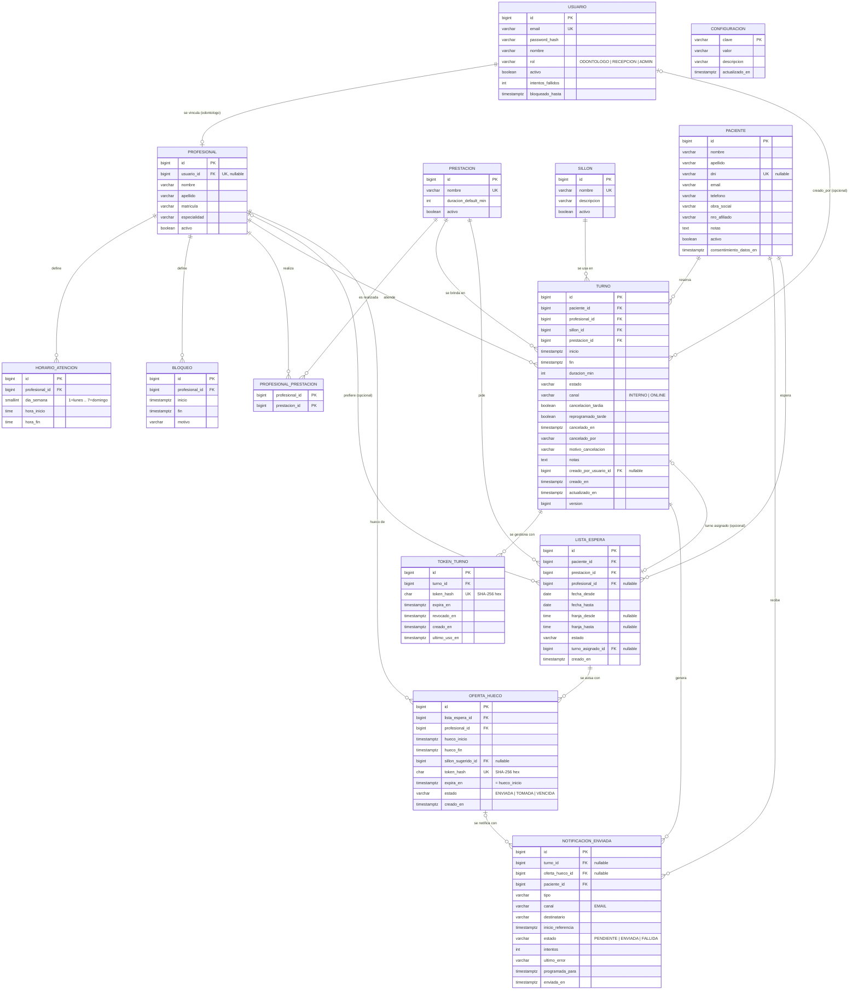

# Modelo de Datos

Base: PostgreSQL 16. El esquema lo genera Hibernate a partir de las entidades JPA (`ddl-auto=update` en dev, `create-drop` en tests); lo que Hibernate no puede generar (extensión `btree_gist` y restricciones `EXCLUDE`) va en `schema-constraints.sql` (ver `08_arquitectura_propuesta.md` y DD-08). Las tablas descriptas acá son el resultado esperado de las entidades. Todas las marcas de tiempo son `timestamptz` (se guardan en UTC); los horarios de atención son `time` locales interpretados en `America/Argentina/Buenos_Aires`. Identificadores `bigint` generados por identidad (**Suposición:** `bigint` autoincremental; el token público nunca usa estos ids).

## Dominios

| Dominio | Entidades |
|---|---|
| Seguridad | Usuario |
| Profesionales y sillones | Profesional, Sillon, HorarioAtencion, Bloqueo, ProfesionalPrestacion |
| Catálogo | Prestacion |
| Pacientes | Paciente |
| Agenda | Turno |
| Reserva pública | TokenTurno |
| Lista de espera | ListaEspera, OfertaHueco |
| Notificaciones | NotificacionEnviada |
| Configuración | Configuracion |

## ERD (Entity Relationship Diagram)



`CONFIGURACION` es una tabla independiente de pares clave-valor (single-tenant, sin relaciones).

## Entidades

### Usuario
- **Atributos:** `id`, `email` (login, único, minúsculas), `password_hash` (BCrypt), `nombre`, `rol` (`ODONTOLOGO`, `RECEPCION`, `ADMIN`), `activo`, `intentos_fallidos`, `bloqueado_hasta`, `creado_en`.
- **Relaciones:** 0..1 `Profesional` (solo si el rol es `ODONTOLOGO`).
- **Constraints:** `email` único; `CHECK (rol IN (...))`.

### Profesional
- **Atributos:** `id`, `usuario_id` (nullable, único), `nombre`, `apellido`, `matricula`, `especialidad`, `activo`.
- **Relaciones:** 1..N `HorarioAtencion`, `Bloqueo`, `Turno`; N..M `Prestacion` vía `ProfesionalPrestacion`.
- **Constraints:** `usuario_id` único cuando no es nulo. **Suposición:** un profesional puede existir sin usuario (no usa el sistema).
- **Índices:** `(activo)`.

### Sillon (box)
- **Atributos:** `id`, `nombre` (ej. "Sillón 1"), `descripcion`, `activo`.
- **Constraints:** `nombre` único.
- **Nota:** el sistema no modela tipos de sillón: **una prestación no requiere un sillón específico, sirve cualquier sillón activo y libre** (decisión del líder 2026-11-20, resuelve PA-04; RN-11).

### Prestacion
- **Atributos:** `id`, `nombre`, `duracion_default_min`, `activo`.
- **Constraints:** `nombre` único; `CHECK (duracion_default_min BETWEEN 5 AND 480)` y múltiplo de 5 (RN-09).

### ProfesionalPrestacion
- **Atributos:** `(profesional_id, prestacion_id)` como clave compuesta.
- **Propósito:** qué prestaciones realiza cada profesional; alimenta la disponibilidad pública y la compatibilidad de la lista de espera (RN-22). **Suposición:** relación necesaria para que la reserva online solo ofrezca combinaciones válidas.

### Paciente
- **Atributos:** `id`, `nombre`, `apellido`, `dni` (nullable), `email`, `telefono`, `obra_social` (texto, es solo un dato), `nro_afiliado`, `notas`, `activo`, `consentimiento_datos_en`, `creado_en`.
- **Constraints:** `dni` único cuando no es nulo; al menos uno entre `email` y `telefono` (RN-32). La reserva online **no pide DNI** (RN-26): lo carga recepción si hace falta; la deduplicación en línea es por email y teléfono (RN-28).
- **Índices:** `(apellido, nombre)`, `(email)`.

### HorarioAtencion
- **Atributos:** `id`, `profesional_id`, `dia_semana` (1 a 7, ISO), `hora_inicio`, `hora_fin` (hora local).
- **Constraints:** `CHECK (hora_fin > hora_inicio)`; un profesional puede tener varios tramos por día, sin superponerse entre sí (se valida en dominio, RN-16).
- **Índices:** `(profesional_id, dia_semana)`.

### Bloqueo
- **Atributos:** `id`, `profesional_id`, `inicio`, `fin`, `motivo`.
- **Constraints:** `CHECK (fin > inicio)`; intervalo semiabierto `[inicio, fin)`.
- **Índices:** `(profesional_id, inicio)`.
- **Suposición:** los bloqueos son por profesional (como en `discovery.md`); el bloqueo de un sillón se resuelve con `sillon.activo = false` (ver PA-12).

### Turno
- **Atributos:** ver ERD. `estado` ∈ {`PROGRAMADO`, `CONFIRMADO`, `ATENDIDO`, `AUSENTE`, `CANCELADO`} (RN-12). `canal` ∈ {`INTERNO`, `ONLINE`}. `duracion_min` guarda la duración efectiva (puede diferir de la de la prestación, RN-03). `fin = inicio + duracion_min`.
- **Relaciones:** N..1 `Paciente`, `Profesional`, `Sillon`, `Prestacion`; 0..N `TokenTurno`; 0..N `NotificacionEnviada`.
- **Constraints:**
  - `CHECK (fin > inicio)` y `CHECK (duracion_min > 0)`.
  - **Restricciones de exclusión** (RN-01, RN-02, RN-10, RN-15). Hibernate no las genera: van en `src/main/resources/schema-constraints.sql`, idempotente, que corre después de Hibernate. Forma conceptual (en el script real cada `ALTER` va dentro de un bloque `DO` que consulta `pg_constraint`):

```sql
CREATE EXTENSION IF NOT EXISTS btree_gist;

ALTER TABLE turno ADD CONSTRAINT turno_sin_solape_profesional
  EXCLUDE USING gist (
    profesional_id WITH =,
    tstzrange(inicio, fin, '[)') WITH &&
  ) WHERE (estado <> 'CANCELADO');

ALTER TABLE turno ADD CONSTRAINT turno_sin_solape_sillon
  EXCLUDE USING gist (
    sillon_id WITH =,
    tstzrange(inicio, fin, '[)') WITH &&
  ) WHERE (estado <> 'CANCELADO');
```

  El rango `'[)'` hace que un turno de 10:00 a 10:30 y otro de 10:30 a 11:00 **no** se solapen (RN-02). Los turnos cancelados quedan fuera de la restricción y liberan el hueco (RN-06, RN-10).
  - `version` (bloqueo optimista de JPA) para ediciones concurrentes del mismo turno.
- **Índices:** `(profesional_id, inicio)`, `(sillon_id, inicio)`, `(paciente_id, inicio)`, `(estado, inicio)`; los índices GiST de las restricciones sirven también para consultas de rango.

### TokenTurno
- **Atributos:** `id`, `turno_id`, `token_hash` (SHA-256 hexadecimal; el token en claro **nunca** se persiste), `expira_en`, `revocado_en`, `creado_en`, `ultimo_uso_en`.
- **Constraints:** `token_hash` único. El token en claro tiene 256 bits de entropía (RN-25). `expira_en` = `inicio` del turno (se recalcula al reprogramar); `revocado_en` se completa en toda cancelación (por el paciente o por el personal).
- **Índices:** `(token_hash)` (único), `(turno_id)`.

### ListaEspera
- **Atributos:** `id`, `paciente_id`, `prestacion_id`, `profesional_id` (preferencia opcional), `fecha_desde`, `fecha_hasta`, `franja_desde`/`franja_hasta` (preferencia horaria opcional, hora local), `estado` ∈ {`ACTIVA`, `ASIGNADA`, `CANCELADA`, `VENCIDA`}, `turno_asignado_id`, `creado_en`.
- **Constraints:** `CHECK (fecha_hasta >= fecha_desde)`; si hay franja, `franja_hasta > franja_desde`.
- **Índices:** `(estado, prestacion_id)`, `(paciente_id)`.

### OfertaHueco
- **Propósito:** aviso automático de un hueco liberado a una entrada de lista de espera compatible (RN-23, RN-38). Es independiente de `TokenTurno` porque todavía no existe un turno.
- **Atributos:** `id`, `lista_espera_id`, `profesional_id`, `hueco_inicio`, `hueco_fin`, `sillon_sugerido_id` (el sillón del turno liberado; solo orientativo), `token_hash`, `expira_en` (= `hueco_inicio`), `estado` ∈ {`ENVIADA`, `TOMADA`, `VENCIDA`}, `creado_en`.
- **Constraints:** `token_hash` único (hash SHA-256 hexadecimal; el token en claro nunca se persiste); `CHECK (hueco_fin > hueco_inicio)`; a lo sumo una oferta por `(lista_espera_id, profesional_id, hueco_inicio)`.
- **Índices:** `(token_hash)` (único), `(estado, expira_en)`.

### Configuracion
- **Atributos:** `clave` (PK), `valor`, `descripcion`, `actualizado_en`.
- **Claves del MVP y valores por defecto:**

| Clave | Default | Significado | Regla |
|---|---|---|---|
| `cancelacion.plazo_horas` | `24` | Horas mínimas de anticipación para cancelar sin penalidad | RN-05 |
| `recordatorio.anticipacion_horas` | `24` | Cuántas horas antes se envía el recordatorio | RN-29 |
| `reserva_online.horizonte_dias` | `60` | Cuántos días a futuro se puede reservar online | RN-27 |
| `reserva_online.anticipacion_minima_horas` | `2` | Anticipación mínima para reservar online | RN-27 |
| `reserva_online.max_turnos_activos_por_email` | `3` | Tope de turnos futuros activos por email | RN-27 |
| `lista_espera.max_avisos_por_hueco` | `10` | Máximo de pacientes avisados por hueco liberado (**Suposición** SU-14) | RN-23 |
| `consultorio.nombre` | `Consultorio Ficticio` | Nombre mostrado en emails y reserva pública | n/a |

La zona horaria **no** es configurable: está fija en `America/Argentina/Buenos_Aires` (RN-14).

### NotificacionEnviada
- **Atributos:** `id`, `turno_id` (nullable), `oferta_hueco_id` (nullable), `paciente_id`, `tipo` ∈ {`RECORDATORIO`, `CONFIRMACION_RESERVA`, `CANCELACION`, `REPROGRAMACION`, `OFERTA_HUECO`}, `canal` (`EMAIL`), `destinatario`, `inicio_referencia` (el `inicio` del turno al momento del envío), `estado` ∈ {`PENDIENTE`, `ENVIADA`, `FALLIDA`}, `intentos`, `ultimo_error`, `programada_para`, `enviada_en`.
- **Constraints:** `UNIQUE (turno_id, tipo, inicio_referencia)` para que el recordatorio sea idempotente y a la vez se reenvíe si el turno se reprograma (RN-30). Los avisos `OFERTA_HUECO` no tienen turno: se asocian a `oferta_hueco_id` (columna nullable, agregada) y la idempotencia es `UNIQUE (oferta_hueco_id, tipo)` cuando no es nula.
- **Índices:** `(estado, programada_para)` para el planificador.

## Seed data inicial

Solo datos **ficticios y claramente inventados**. Se carga con un componente `DevDataSeeder` (paquete `shared`, idempotente) habilitado solo en el perfil `dev`; no se usa `data.sql` para el seed porque correría en todos los perfiles. Las contraseñas del seed **no** figuran en esta KB ni se versionan en claro en el código: se leen de variables en `.env.example` (`SEED_ADMIN_PASSWORD`, etc.).

| Entidad | Datos de ejemplo |
|---|---|
| Usuario | `admin@consultorio.test` (ADMIN), `recepcion@consultorio.test` (RECEPCION), `odonto1@consultorio.test` y `odonto2@consultorio.test` (ODONTOLOGO) |
| Profesional | "Ana Ficticia" (matrícula `MP-0001`, Odontología general) y "Bruno Inventado" (matrícula `MP-0002`, Ortodoncia), vinculados a `odonto1` y `odonto2` |
| Sillon | "Sillón 1", "Sillón 2", "Sillón 3" |
| Prestacion | Consulta (30 min), Limpieza (45 min), Extracción simple (30 min), Tratamiento de conducto (90 min), Control de ortodoncia (20 min) |
| HorarioAtencion | Lunes a viernes 09:00-13:00 y 15:00-19:00 para ambos profesionales |
| Paciente | "Paciente Prueba Uno" (DNI `00000001`), "Paciente Prueba Dos" (DNI `00000002`), "Paciente Prueba Tres" (DNI `00000003`), emails `paciente1@example.test` etc., teléfonos `0000-000001`, obra social "Obra Social Ficticia" |
| Configuracion | Los valores por defecto de la tabla anterior |
| Turno | Un puñado de turnos de ejemplo en la semana corriente, incluido un par contiguo (10:00-10:30 y 10:30-11:00) para ilustrar RN-02 |

Los DNIs `00000001` y siguientes no corresponden a personas reales. Ninguna migración, fixture ni test debe contener nombres, DNIs o emails reales.
